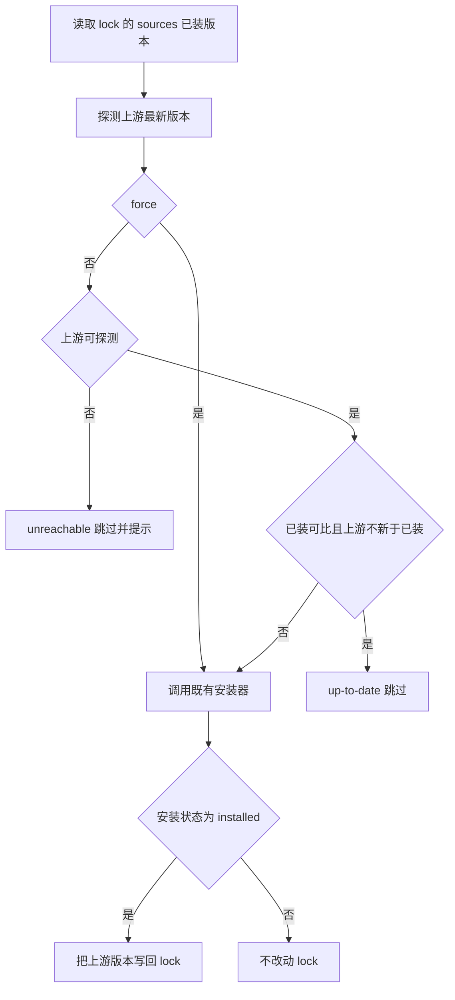

## 产品概述

修正 `polaris update` 的第三方依赖更新行为：openspec、superpowers、codegraph 在版本没有更新时不重新安装，且整个流程对「版本是否真的有变化」给出可确认的状态回显。

## 核心特性

- **版本未变化即跳过**：已装版本与上游最新版本一致（或已装版本更新）时，不执行任何安装动作，终端回显「已是最新」。
- **无法确认版本时不再静默重装**：上游版本探测不到时不视为「有更新」，跳过安装并明确提示「无法确认版本」，不再每次都跑一遍无意义的安装。
- **状态记录可比较**：安装成功后把可比较的版本回写到本地安装记录；缺少或无法比较的旧记录只触发一次安装以建立基线，之后稳定跳过。
- **强制更新仍可用**：`--force` 保持强制重新安装，并在安装后正确回写版本。
- **终端按组件回显**：每个组件输出「已是最新 / 无法确认版本 / 已安装（含版本号）」，与资产层「未变即跳过」的既有表现一致。

## 1. 技术栈选择

沿用仓库现有栈，不引入任何依赖：TypeScript（ESM）+ Node `child_process`/`fs` + vitest。`src/cli → src/commands → src/core → src/utils` 的依赖方向不变；`.polaris/skills-lock.json` 继续作为本地已安装状态的唯一事实来源。

## 2. 实现思路与关键决策

### 根因（已通过只读代码核查确认）

- [KNOWN] `src/commands/update.ts:164-169` 的 `hasNoVersionUpdate(installed, latest)` 在 `!installed || !latest` 或任一版本不可比时返回 `false`，语义是「不跳过、交给安装器」，与「版本没变就不重装」的诉求相反。
- [KNOWN] superpowers 的安装结果恒为不可比占位符：`src/core/integrations/superpowers.ts:159` 返回 `npx-latest`（其余通道为 `local` / `HEAD` / `failed`），该值写入 lock 后 `isConcreteVersion`（`update.ts:160-162`）判 false，导致每次必重装。`test/ts/update-deps-version.test.ts:44-47` 还把这一行为固化为预期。
- [KNOWN] openspec/codegraph 的判定输入是 `npm list -g`（失败返回字符串 `0.0.0`，`src/core/deps/npm.ts:40-56`）与 `npm view`（失败返回 `null`，`npm.ts:225-250`），而 lock 中这两条 `sources[].version`（`update.ts:353/390`）只写不读，是死数据。
- [KNOWN] 探测与安装不同源：探测固定走 `resolveNpmRegistry()`（内网 Nexus，`src/core/config/polaris-constants.ts:18`），安装走 `resolveInstallChannelConfig().npmRegistry`（`src/core/install/channels.ts:167-179`）；superpowers 判定走 `git ls-remote` 且未传 mirror，安装走 npx 默认分支。
- [INFERRED] macOS 上全局 npm 目录不可写时 CLI 落到 `~/.polaris/cli`（`npm.ts:120-125`），`npm list -g` 查不到即返回 `0.0.0`，是三个组件同时重装的常见触发路径。
- [KNOWN] 三个 core 安装器内部完全没有版本门控，一律 `@latest` 重装，因此一旦判定放过就会真的跑一遍安装、装完仍是同一版本。

### 决策与权衡

1. **判定改为结构化状态，而非布尔值**：`hasNoVersionUpdate` 无法区分 up-to-date 与 unreachable。新增 `resolveDepUpdateAction(installed, latest, force)` 返回 `skip(reason)` 或 `install`，把「上游不可达 → 跳过并提示」显式化。理由：程序层 `src/core/deps/self-update.ts:26` 已有 `updated / up-to-date / skipped / unreachable / failed` 这一正确范式，deps 层直接对齐即可，属于复用既有约定而非新建抽象。
2. **判定逻辑下沉到 `src/core/update/dep-version.ts`**：当前纯函数放在 commands 层违反「业务语义下沉 core」；下沉后可单测、`update.ts` 保持纯编排。删除旧导出、同步改测试 import，不加兼容层（遵循项目「不保留向后兼容」）。
3. **三个组件统一以 lock 的 `sources[].version` 作为「已装版本」**：与 assets 层用 lock 指纹门控的既有正确做法一致，消除 `npm list -g` 的 `0.0.0` 误判；不再依赖本地全局包探测作为判定输入。
4. **写入 lock 的版本统一为「本次解析到的上游版本」**：openspec/codegraph 用 `getLatestNpmVersion` 结果，superpowers 用 `resolveVersion` 的 tag，不再写 `npx-latest` 等占位符，也不再安装后二次 `npm list -g`。取舍说明：superpowers 的 npx 通道实际装的是默认分支，tag 仅作「上游是否变化」的信号，此近似必须用中文注释写清，避免被误读为精确版本绑定。仅在 `status === 'installed'` 时回写，避免失败时把期望版本记成已装。
5. **不动三个 core 安装器、不动 init 的门控、不动 assets 指纹层、不动 program 层**：安装器被 init 共用，内部加版本门控会破坏 init 语义；判定是编排层职责。这是本次的爆炸半径控制。
6. **`--force` 改为独立布尔参数**：现有实现把 `latest` 置 `null` 来强制重装（`update.ts:343/360/378`），与「探测失败」不可区分，且导致安装后无版本可回写。改为始终探测上游、`force` 只影响判定结果。
7. **探测源与安装源对齐**：`getLatestNpmVersion` 增加可选 `registry` 参数，`undefined` 保持默认 Nexus（供 `src/core/deps/version.ts` 的 `getLatestVersion()` 查私有包），显式 `null` 表示不指定 `--registry`；update 传 `channel.npmRegistry ?? null`。superpowers 的 `resolveVersion` 传入 `channel.githubMirror`。这是必要的正确性修复，不是兼容层。
8. **性能**：每次 update 每个组件各一次网络探测，均为带短超时的单次查询；`resolveDepUpdateAction` 为纯函数 O(1)，无循环内重复探测；判定表驱动，无额外 I/O 与重复遍历。

### 判定矩阵

| 已装版本 | 上游版本 | force | 动作 |
| --- | --- | --- | --- |
| 具体版本 | 具体版本，不新于已装 | 否 | skip / up-to-date |
| 具体版本 | 具体版本，新于已装 | 否 | install |
| 具体版本 | 不可达 | 否 | skip / unreachable，lock 不变 |
| 缺失或不可比 | 具体版本 | 否 | install（建立基线） |
| 缺失或不可比 | 不可达 | 否 | skip / unreachable |
| 任意 | 任意 | 是 | install |


## 3. 实施注意事项

- 复用 `t(lang, ...)` 与 `src/commands/i18n/messages.yaml`：新增 `updateDepUnreachable`（zh/en），中文措辞遵循术语规范，不写「门」类直译；不要静默跳过，必须给出可行动提示（可 `--force` 重试）。
- `UpdateDependencyResult.status` 新增 `unreachable` 取值，仅 CLI 输出消费（`update.ts:457-459`），不影响 dashboard。
- 代码文件与函数必须写中文注释，准确说明「已装版本 = 上次安装对应的上游版本」；`src/commands/update.ts` 顶部文件注释里关于「与 init 语义差异」的段落需同步更新。
- 顺手清理 `update.ts:388` 的 `version ?? 'latest'` 兜底字符串，避免输出不可比版本。
- 提交前按项目规范跑 `pnpm format:check`、`pnpm lint`、`pnpm build`、`pnpm test`。
- Changelog：先用 `git show master:package.json` 确认 master 版本号，再决定升一个版本或追加到已比 master 大的现有条目；当前本地 `package.json` 与 `CHANGELOG.md` 顶部均为 `0.9.1`（2026-11-09），不可直接假定。

## 4. 架构设计

数据流：`readLockFile` → `resolveDepUpdateAction`（core 纯判定）→ 跳过或调用既有安装器 → 仅成功时 `saveLockFile` 回写 `sources[].version` → 回显状态。判定层与安装层解耦，安装器保持「只管装」。



## 5. 目录结构

```
polaris-flow/
├── src/
│   ├── core/
│   │   ├── update/
│   │   │   └── dep-version.ts            # [NEW] 依赖版本判定。导出 isConcreteVersion 与 resolveDepUpdateAction，实现上表判定矩阵；纯函数、无 I/O、无网络，便于单测。文件注释写明「已装版本取 lock.sources」与 superpowers tag 仅作变更信号的近似语义。
│   │   └── deps/
│   │       └── npm.ts                    # [MODIFY] getLatestNpmVersion 增加可选 registry 参数：undefined 用 resolveNpmRegistry()（程序私有包不变），null 不指定 --registry（与安装一致）。保留超时与零重试。getNpmPackageVersion 保留供 init 使用，不参与 update 判定。
│   ├── commands/
│   │   ├── update.ts                     # [MODIFY] 删除 isConcreteVersion / hasNoVersionUpdate 旧导出；deps 三段分支统一读 sourceEntries 作为 installed；始终探测 latest；--force 作独立参数；调用 resolveDepUpdateAction；仅 installed 时把具体上游版本写回 sourceEntries；superpowers 的 resolveVersion 传 channel.githubMirror；getLatestNpmVersion 传 channel.npmRegistry ?? null；新增 unreachable 状态与回显；更新文件头注释。
│   │   ├── init.ts                       # [MODIFY] lock 的 superpowers source 写入改为可比较的上游 tag（resolveVersion 结果），不再写 npx-latest 等占位符；openspec/codegraph 写入侧保持 getNpmPackageVersion 但避免把 0.0.0 当有效版本；安装门控（文件存在性）不动。
│   │   └── i18n/
│   │       └── messages.yaml             # [MODIFY] 新增 updateDepUnreachable 的 zh/en 文案；沿用 updateDepUpToDate 现有文案。
│   └── core/install/lock.ts              # [AFFECTED] 结构不变，仅被 update/init 读写；确认 sources 合并逻辑（update.ts:396-427）不会被占位符污染。
├── test/ts/
│   ├── update-deps-version.test.ts       # [MODIFY] import 改为 src/core/update/dep-version.js；断言改为新语义：上游不可达返回 skip/unreachable、缺失或不可比触发 install、force 强制 install、相等时 up-to-date。删除「npx-latest 必重装」的旧断言。
│   ├── update-deps.test.ts               # [NEW] deps 分支端到端回归。用 vi.mock 屏蔽三个安装器与版本探测函数，复用 makeInstalledProject 式夹具；断言版本未变时 deps 全为 up-to-date 且安装器零调用、上游不可达时零调用且 lock 不变、有更新时安装器被调用且 lock 写回新版本、force 强制安装、脏占位符只装一次并建立基线。
│   └── update.test.ts                    # [AFFECTED] 确认既有「资产指纹未变整体跳过」与 --force 用例不受影响；如新增 deps 用例统一放 update-deps.test.ts，避免文件继续膨胀。
├── CHANGELOG.md                          # [MODIFY] 按规范置顶或追加版本条目，以 Fixed / Tests 分组，描述行为变更（版本未变不再重装、不可达不再静默安装）。
└── package.json                          # [MODIFY] 仅在确认 master 版本后需要升版时改 version，与 CHANGELOG 一致。
```

## 6. 关键代码结构

```ts
/** 单个依赖的更新决策 */
export type DepUpdateAction =
  | { kind: 'skip'; reason: 'up-to-date' | 'unreachable'; version: string | null }
  | { kind: 'install'; version: string | null };

/** 依据 lock 中已装版本、上游最新版本与强制标记决定是否重装（纯函数） */
export function resolveDepUpdateAction(
  installed: string | null,
  latest: string | null,
  force: boolean,
): DepUpdateAction;

/** 版本字符串是否可作 semver 比较（去 v 前缀，形如 x.y.z） */
export function isConcreteVersion(version: string): boolean;
```

`UpdateDependencyResult.status`（`src/commands/update.ts`）取值扩展为 `up-to-date | unreachable | installed | failed | skipped`，其余字段不变。

## Agent Extensions

### Skill

- **test**
- Purpose: 为 deps 版本判定补齐单元测试与端到端回归测试，并运行全量测试验证
- Expected outcome: 覆盖「版本未变跳过 / 上游不可达跳过 / 有更新安装 / force 强制 / 脏占位符建立基线」五类场景，且「安装器零调用」的断言通过，全量测试无回归
- **review**
- Purpose: 评审改动是否符合分层约定与 lock 唯一事实来源，检查是否波及 init / assets / program 三层
- Expected outcome: 输出无回归风险的评审结论，确认三个 core 安装器、init 安装门控、assets 指纹层与程序层默认 registry 行为均未改变