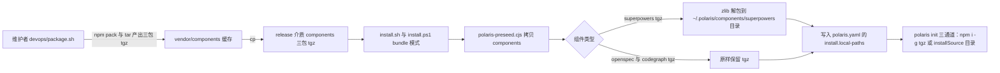

## 用户需求

把离线安装包中的 openspec、superpowers、codegraph 三个依赖统一为 tgz 离线包：vendor 缓存与 release 介质的 components 目录形态一致。因 superpowers 运行时只接受目录，改由 preseed 在安装阶段解包还原为目录，运行时代码零改动。

## 产品概述

维护者用 devops/package.sh 生成离线介质（release-版本号-日期），供内网或无网环境的用户安装 polaris-flow 后仍能通过 polaris init 装齐三个伴生组件。当前三包形态不一致（两个 tgz 加一个源码目录），本次统一为 tgz，并清理缓存目录散乱问题。

## 核心功能

- vendor 缓存统一到 devops/vendor/components 下的三个 tgz，替代原 vendor/tgz 与 superpowers 源码直放。
- package.sh 产出的介质 components 目录下三包全为 tgz，bundle-manifest 与注释、结束输出同步。
- preseed 用 Node 内置 zlib 解析 tar 流，把 superpowers tgz 解包到 ~/.polaris/components/superpowers，local-paths 仍指向目录。
- 多版本缓存按语义化版本比较选最高版本，修正现有字典序误选。
- 新增解包单测并更新 CHANGELOG。

## 技术选型

- 打包侧沿用 Bash 与系统 tar：devops/package.sh 已依赖 git/npm/node，维护者机器为 macOS 或 Linux。统一用 tar -czf 目标 -C 源目录 . 的写法，避开 BSD 与 GNU tar 的差异选项。superpowers 不用 npm pack：其 package.json 无 files 白名单、.gitignore 排除 evals，npm pack 会多出 package 一层前缀，导致解包后 skills 不在根、对不上运行时的 skillsPath。
- 安装侧用 Node.js CommonJS：polaris-preseed.cjs 随离线介质独立分发，跑在用户机器且没有项目 node_modules，Windows 也不保证系统 tar 在 PATH。因此解包只用 Node 20 内置的 zlib、fs、path，零第三方依赖。
- 测试沿用 Vitest 与 test/ts 下 *.test.ts 命名；配置源仍是 ~/.polaris/polaris.yaml 的 install.local-paths，格式不变。

## 实现思路

把三个组件抽象成同一个缓存优先的打包流程：缓存文件名统一为 前缀-版本号.tgz，命中缓存且非 --refresh 时直接复用，否则调用各自的生成器（openspec/codegraph 用 npm pack，superpowers 用 tar 打源码目录根）回写缓存再拷贝进介质。superpowers 的源码目录退居为上游 clone 的构建中间态，vendor 的持久形态只有 tgz。安装侧 preseed 保持拷贝 components 到 ~/.polaris/components，额外对 superpowers tgz 做一次解包，利用 findComponent 目录优先的既有行为让 local-paths 自然指向解压目录。选择 preseed 解包而非改运行时，是因为 openspec/codegraph 的本地通道是 npm i -g 原生吃 tgz，只有 superpowers 的 installSource 需要目录，改动面最小且 src 完全不动。

关键取舍：介质里保留 superpowers tgz 不删，与解压出的目录并存，延续原注释中持久载体防用户删目录后断粮的设计。不新增任何旧介质目录形态的兼容分支。版本选择由字典序 pop 改为按点分数字比较，避免 1.9.0 被误选为高于 1.16.1。

性能与可靠性：tar 解包与拷贝均为单遍线性处理，内存占用等于一个 tgz 的解压缓冲（superpowers 约数 MB，可接受）；不做异步并发，避免 preseed 复杂度上升。安全上拒绝绝对路径、含 .. 的路径与符号链接条目，防止恶意介质写穿到家目录。

## 实施注意事项

- 依赖方向不变，改动集中在 devops 与 test，src 不动；不引入新依赖。
- preseed 复用现有 info/warn 风格输出，解包失败沿用 warn 不中断的语义，但要打印具体条目名便于定位。
- 幂等：重跑 preseed 先删除旧的解包目录再解压；拷贝 components 时逐个 rmSync 目标，注意只删源里存在的条目，解压目录由解包步骤自行清理。
- 版本解析：resolve_superpowers_version 逻辑与 --superpowers ref 钉选语义保留；源码中间态用 .polaris-version 作为版本真值，缓存命中时跳过 clone，缓存未命中且源码版本不符时重新 clone，避免 tgz 文件名与内容版本错配。
- 迁移时把 vendor/tgz 下现有 7 个 tgz 移动到 vendor/components 再删空目录；两者都被 .gitignore 的 devops/vendor/* 覆盖，无需改 .gitignore。

## 架构设计



## 目录结构

```
polaris-flow/
├── devops/
│   ├── package.sh                 # [MODIFY] 缓存目录改到 vendor/components；把 pack_cli 抽成通用缓存优先的 pack_component；superpowers 由 cp 源码目录改为 tar -czf 产出 superpowers-版本号.tgz；manifest 的 superpowers type 改 tgz；头部注释与结束输出同步；保留 refresh、钉版本、多版本缓存
│   ├── polaris-preseed.cjs         # [MODIFY] 新增 zlib.gunzipSync 与极简 tar 解析，解包 superpowers tgz 到 ~/.polaris/components/superpowers；findComponent 按语义化版本选最高；目录优先逻辑使 local-paths 指向解压目录；路径穿越与符号链接防护；补中文函数注释
│   └── vendor/
│       ├── tgz/                    # [REMOVE] 缓存迁到 components 后删除，本地 mv 现有 7 个 tgz，gitignored 无需 git 操作
│       └── components/             # [MODIFY] 统一缓存目录，容纳三包 tgz，已被 devops/vendor/* 忽略
├── test/
│   └── ts/
│       └── polaris-preseed.test.ts # [NEW] preseed 单测，覆盖三组件 local-paths、多版本语义化选版、恶意路径穿越拒绝、重复执行幂等；用子进程加临时 HOME 运行脚本
└── CHANGELOG.md                    # [MODIFY] 对照 master 版本决定新增或追加条目，记录三包 tgz 统一与 preseed 解包的行为变更
```

## 关键代码结构

```
// polaris-preseed.cjs 内新增的解包契约（仅签名与语义，无实现体）
// gunzipAndExtractTar(tgzPath, destDir) -> void
// 遍历 512 字节 tar 头，解析 name/prefix/size/typeflag；
// 处理普通文件与目录，兼容 GNU longname 与 pax path 头；
// 跳过符号链接，拒绝绝对路径与 .. 段，按 size 对齐跳过数据块。
```

```
# package.sh 内通用打包契约
# pack_component 缓存前缀 产物目录 生成器 -> 回显版本号
# 缓存命中且非 refresh 直接复用，否则执行生成器回写缓存后拷贝。
```