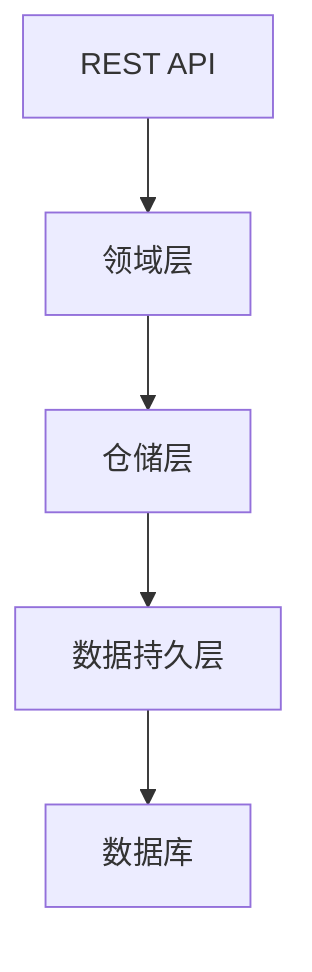

# design-template.md 模板（plan 阶段 · 高层设计）

> **使用约定**：由 `polaris{{SKN_SPR}}coding{{SKN_SPR}}plan` Step 4.2 组装输入时读取，Step 4.4 按 `./policies/artifact-batch-generation.md` 的 `design` 批次生成，落盘到 `openspec/changes/<change_id>/design.md`；Step 5.1 机械终检按本模板的节名与节序校验。
>
> **本阶段深度边界**：只写高层方案（架构决策、模块 / 领域划分、模块间接口契约、数据流）。**禁止**写到 `detailed-design.md` 或 `<slug>-design.md` 专项设计的粒度——实现级细节归 `design` 阶段；确需实现级设计时走 Step 6.1 深化设计决策点。
>
> **节名与编号约定**：节名一律中文，与 Step 5.1 机械终检同源；三个必含节的措辞不得改写，编号连续（新增节只在末尾顺延）。

## 模板正文

```markdown
# {{CHANGE_ID}} — 技术实现方案

>**编写人**：{name}
>**编写日期**：{YYYY-MM-DD}

## 1. 概述
**背景**：{{BACKGROUND_ONE_SENTENCE}}

**目标**：
{{GOAL}}

**非目标**:
{{NON_GOAL}}

## 2. 前提
{{PREMISES}}

## 3. 原则与依据
{{CONSTITUTION_ALIGNMENT}}

## 4. 方案内容
### 4.1 技术栈
{{TECH_STACK}}

### 4.2 整体方案思路

### 4.3 架构总览


### 4.4 模块 / 领域划分
<!-- normal 核心节：模块清单 + 每个模块的职责边界 -->
{{MODULE_DIVISION}}

### 4.5 模块间接口契约
<!-- normal 核心节：跨模块调用的接口、数据结构、时序约定 -->
| 调用方 | 提供方 | 接口 / 契约 | 说明 |
| --- | ------ | ---------- | ---- |
{{MODULE_INTERFACES}}

### 4.6 数据流
{{DATA_FLOW}}

### 4.7 功能实现方案
{{CORE}}

### 4.8 存储方案

#### 4.8.1 持久化方案
{{PERSISTANCE}}

#### 4.8.2 缓存方案
{{CACHE}}

### 4.9 API 实现策略

| 业务域 | 接口名称 | 路径 | 方法 | 业务目的 | 重要程度 |
| --- | ------- | --- | ---  | ------ | ------- |
{{RESTFUL_API_LIST}}

### 4.10 异常、并发、事务处理策略

### 4.11 风险与降级方案
<!-- Step 6 守门选 B 时的「风险接受记录」追加在本节 -->

## 5. 未选方案及拒绝理由
{{ALTERNATIVES}}

## 6. 待确定问题
{{OPEN_QUESTIONS}}
```

---

## 强制规则

1. **必含节**：`## 2. 前提`、`## 3. 原则与依据`、`## 5. 未选方案及拒绝理由`——措辞原样保留，缺任一 → Step 5.1 机械终检阻断
2. **节名与编号**：不得改动节名措辞与编号顺序；新增节一律追加到末尾并顺延编号
3. **深度上限**：写到契约级（谁调谁、传什么、什么时序），不写实现级伪码；需要实现级设计 → 交 `design` 阶段
4. **模板变量**：正文中所有 `{{...}}` 必须在生成时替换为真实值，不得原样留空
