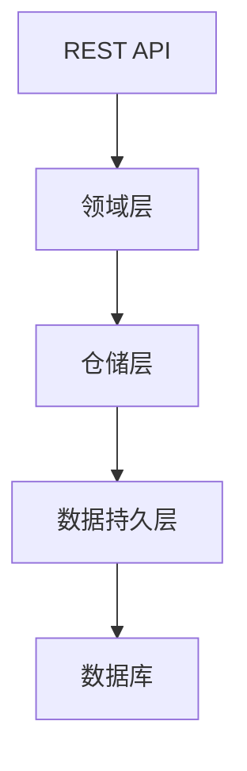

# design-template.md 模板（plan 阶段 · 高层设计）

> **使用约定**：由 `polaris{{SKN_SPR}}coding{{SKN_SPR}}plan` Step 4.2 组装输入时读取，Step 4.4 按 `./policies/artifact-batch-generation.md` 的 `design` 批次生成，落盘到 `openspec/changes/<change_id>/design.md`；Step 5.1 机械终检按本模板的节名与节序校验。
>
> **本阶段深度边界**：只写高层方案（架构决策、模块 / 领域划分、模块间接口契约、数据流）。**禁止**写到 `detailed-design.md` 或 `<slug>-design.md` 专项设计的粒度——实现级细节归 `design` 阶段；确需实现级设计时走 Step 6.1 深化设计决策点。
>
> **节名与编号约定**：节名一律中文，与 Step 5.1 机械终检同源；三个必含节的措辞不得改写，编号连续（新增节只在末尾顺延）。**唯一例外**：`## 0. 核心结论` 为前置结论节，固定置于 `## 1. 概述` 之前，不计入末尾顺延。

## 模板正文

```markdown
# {{CHANGE_ID}} — 技术实现方案

>**编写人**：{name}
>**编写日期**：{YYYY-MM-DD}
> 本文为 AI 生成初稿，标注「待人工核验」的项需人工确认。

## 0. 核心结论
<!-- 结论前置：读者最先看到决策与风险，正文再展开论证。两表必须非空，禁止只写正文不填本节 -->
### 0.1 核心架构决策清单
| 决策 | 选型结论 | 一句话理由 | 详见 |
| --- | --- | --- | --- |
{{CORE_DECISIONS}}

### 0.2 核心风险清单
| 风险 | 影响 | 缓解 | 详见 |
| --- | --- | --- | --- |
{{CORE_RISKS}}

## 1. 概述
**背景**：{{BACKGROUND_ONE_SENTENCE}}

**目标**：
{{GOAL}}

**核心矛盾（Top3）**：
<!-- 全局业务主次取舍，指导方案「抓核心、不平均用力」 -->
{{CORE_TENSIONS}}

**非目标**:
{{NON_GOAL}}

## 2. 前提
{{PREMISES}}

## 3. 原则与依据
{{CONSTITUTION_ALIGNMENT}}

## 4. 方案内容
### 4.1 技术栈
{{TECH_STACK}}

### 4.2 整体方案思路

### 4.3 架构总览


### 4.4 模块 / 领域划分
<!-- normal 核心节：模块清单 + 每个模块的职责边界 -->
{{MODULE_DIVISION}}

### 4.5 模块间接口契约
<!-- normal 核心节：跨模块调用的接口、数据结构、时序约定 -->
| 调用方 | 提供方 | 接口 / 契约 | 说明 |
| --- | ------ | ---------- | ---- |
{{MODULE_INTERFACES}}

### 4.6 数据流
<!-- 必须覆盖：正常主流程 + 失败 / 降级 / 熔断三类关键异常分支的顶层流转（与 §4.10 呼应）；禁止只画正向流转 -->
{{DATA_FLOW}}

### 4.7 功能实现方案
{{CORE}}

### 4.8 存储方案

#### 4.8.1 持久化方案
{{PERSISTANCE}}

#### 4.8.2 缓存方案
{{CACHE}}

### 4.9 API 实现策略
<!-- 仅「接口存在性契约」：列谁提供、路径、方法、业务目的；字段级契约（请求/响应/错误码/限流/超时/重试）下沉 design 阶段 restful-api 专项 -->
| 业务域 | 接口名称 | 路径 | 方法 | 业务目的 | 重要程度 |
| --- | ------- | --- | ---  | ------ | ------- |
{{RESTFUL_API_LIST}}

### 4.10 异常、并发、事务处理策略

### 4.11 风险与降级方案
<!-- 强制三件套，缺一不可：过度设计风险 / 首版遗漏风险 / 最可能重构的部分 -->
{{RISKS_AND_FALLBACK}}
<!-- Step 6 守门选 B 时的「风险接受记录」追加在本节 -->

### 4.12 业务-技术映射
<!-- 每个技术组件标注对应的业务场景与业务价值，禁止无业务锚点的技术堆砌 -->
| 技术组件 | 业务场景 | 业务价值 |
| --- | --- | --- |
{{BUSINESS_TECH_MAPPING}}

## 5. 未选方案及拒绝理由
<!-- 候选方案量化对比 + 未选方案拒绝理由（见「强制规则」第 5 条） -->
### 5.1 候选方案对比矩阵
<!-- ≥2 个方案（含选定与未选）× 5 维量化对比：性能 / 成本 / 复杂度 / 交付周期 / 运维门槛；末尾给推荐依据 -->
{{CANDIDATE_COMPARISON_MATRIX}}

### 5.2 未选方案及拒绝理由
<!-- 每个未选方案强制「背景 / 选型理由 / 取舍权衡」三段 -->
{{ALTERNATIVES}}

## 6. 待确定问题
{{OPEN_QUESTIONS}}
```

---

## 强制规则

1. **必含节**：`## 2. 前提`、`## 3. 原则与依据`、`## 5. 未选方案及拒绝理由`——措辞原样保留，缺任一 → Step 5.1 机械终检阻断
2. **节名与编号**：不得改动节名措辞与编号顺序；新增节一律追加到末尾并顺延编号（`## 0. 核心结论` 为唯一前置例外）
3. **结论前置**：`## 0. 核心结论` 的「核心架构决策清单」与「核心风险清单」两表必须非空，禁止只写正文不填前置结论
4. **深度上限 + 粒度红线**：写到契约级（谁调谁、传什么、什么时序），不写实现级伪码；**禁止**出现表字段、具体错误码、方法名 / 类名；`### 4.9` 只列「接口存在性契约」（路径 / 方法），字段级契约交 `design` 阶段 restful-api 专项
5. **候选方案量化对比**：`## 5.1` 必须给 ≥2 方案 ×（性能 / 成本 / 复杂度 / 交付周期 / 运维门槛）5 维量化对比 + 推荐依据；每个未选方案在 `## 5.2` 附「背景 / 选型理由 / 取舍权衡」
6. **风险三件套**：`### 4.11` 必须覆盖「过度设计风险 / 首版遗漏风险 / 最可能重构的部分」三项
7. **业务-技术映射**：`### 4.12` 每个技术组件必须标注业务场景与业务价值，禁止无锚点堆砌
8. **数据流闭环**：`### 4.6` 必须覆盖失败 / 降级 / 熔断分支，禁止只画正向主流程
9. **模板变量**：正文中所有 `{{...}}` 必须在生成时替换为真实值，不得原样留空
10. **防幻觉溯源**：技术特性、版本能力、性能数据必须标注来源，禁止「经测试满足」「已验证可支撑」等未证实结论；拿不准的标 TBD 或「待人工核验」
