# coding 工作流技能流程图

> 本文档描述 `assets/zh/skills/coding/` 下 11 个技能的组织方式与流转关系（含 2026-10-12 新增的受理入口 `intake`）。
>
> **权威源**（本文档与它们冲突时以它们为准）：
>
> | 内容 | 唯一来源 |
> |------|----------|
> | 阶段序列与各阶段产物 | `src/core/config/task-kind-layout.ts` 的 `kind: 'coding'` 条目 |
> | 各技能内部步骤 | 各技能目录下的 `SKILL.md` |
> | 阶段衔接方式（manual / auto） | `assets/zh/policies/auto-transition.md` |
> | **恢复分发（`mode` → 通道 / 游标 `phase` → 技能）** | `src/core/config/task-kind-layout.ts` 的 `skillForModePhase` |
> | 档位升降判定 | `assets/zh/skills/coding/normal/policies/tier-gate.md` + `assets/zh/policies/risk-signals.md` |
> | 人工确认协议 | `assets/zh/policies/decision-point.md` |
>
> 文档不含菜单编号（C/M/R/P/T 前缀码属命令层 UI 概念，技能层不引用）。

---

## 1. 三条通道总览

coding 技能族不是一条流水线，而是**三个入口档位**加一个**旁路复盘**。三条通道最终都汇聚到 `ship`。

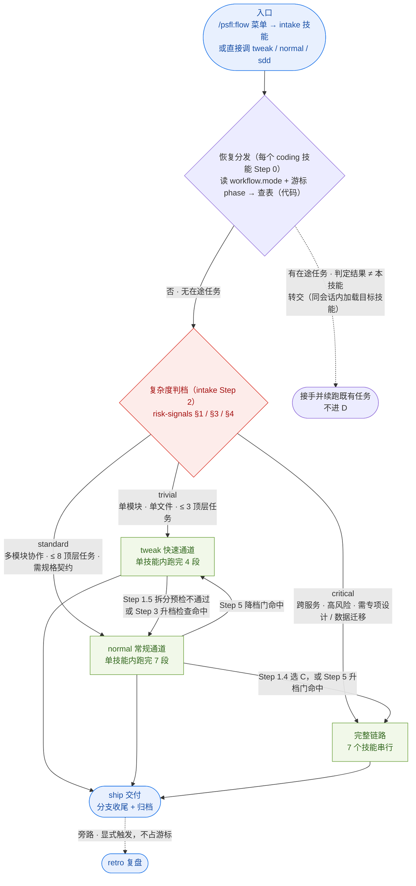

三条通道的差异：

| 维度 | tweak | normal | 完整链路 |
|------|-------|--------|----------|
| 适用 | 单模块 / 单文件级、≤ 3 顶层任务、≤ 1 delta spec | 多模块协作、需规格契约、≤ 8 顶层任务 | 跨服务 / 高风险、需专项设计与复盘 |
| 承载技能数 | 1（`tweak`） | 1（`normal`） | 7（`specify` → `plan` → `design`? → `tasks` → `build` → `verify` → `ship`） |
| 规格产物 | `change-brief.md` + `tasks.md` | OpenSpec 四件套 + `intention.md` + 终版 `tasks.md` | 四件套 + `detailed-design.md` + 专项设计 |
| 独立主审 | 无 | 1 次合并主审 | design 主审 + tasks 主审 + 可选 Outside Voice |
| 人工确认次数 | 3 次 | ~5 次 | ≥ 10 次 |
| workflow 游标写入 | **仅 1 次**（出口推 ship） | **仅 1 次**（出口推 ship） | 每阶段 1 次 |
| ship 是否需补齐四件套 | **需要**（`artifact-backfill`） | 不需要 | 不需要 |
| metrics（scorer） | 照写 | 照写 | 照写 |

> **关键设计**：`tweak` 与 `normal` 把多段流程压缩进**一个技能**，因此中间不推游标 —— 全程只有出口那一次 `phase=ship` 写入。进度只能靠落盘产物判断，不能靠 `state.yaml.phase`。

### 1.1 恢复判据（2026-10-12 落地；同日定稿为「代码阶段表 + 查表转交」）

**`workflow.mode` 决定通道，游标 `phase` 决定技能。** 判据的唯一源是**代码阶段表**：

- 派生函数：`src/core/config/task-kind-layout.ts` 的 **`skillForModePhase(kind, phase, mode)`**
  —— coding 的 `specify` / `plan` 两行登记 `channelSkill: { tweak, normal }`，其余阶段同名回落；
  与 `skillForPhase` 的差别：本函数对**入口阶段**返回同名技能（分发要回答「该进哪个技能」）。
- 命令入口：`polaris-flow workflow-entry get-active-changes --kind coding --format full`
  → 每行含 `task_id` / `phase` / `mode` / **`skill`（= 应执行技能）** / `worktree_path`。
- ⇒ 技能 Step 0 **只读 `skill` 字段**，不复制任何表格。
  （该表曾短暂用 policy 文件承载，已废弃 —— 「配置归代码」是本次的裁定。）

- **通道落盘**：`state.yaml` 的 `workflow.mode`，值域 **`tweak | normal | strict`**（`strict` = 端到端全走）。模板默认 `normal`。
- **三入口建任务后立即写 `mode`**：`tweak` / `normal` / `specify` 在各自 Step 0/1 落 `append-active`（建游标条目，`phase=specify`）**并**写自己的 `workflow.mode` —— 否则新会话按 `mode` 检索时找不到该任务。
- **各技能 Step 0 查表转交**：`specify` / `plan` / `design` / `tasks` / `build` / `verify` / `ship` / `tweak` / `normal`
  的 Step 0 一律用 `get-active-changes --kind coding --format full`（**不带 `--phase`**，候选取**全部在途任务**）
  → 读每行的 `skill`：
  - 命中**本技能** → 接手，跳到文末「上下文压缩恢复」表里 `phase` 对应的 Step；
  - 命中**他技能** → **转交**（同会话内加载目标技能，不要求用户再敲命令），转交上限 2 跳。
  ⚠️ 之所以**不能**按 `--phase <本阶段>` 预先过滤：单体通道的 `tweak` / `normal` 会把游标推成
  `plan` / `ship`，预先过滤会让「他阶段的在途任务」被判成「零匹配」而走错分支。
- **`phase=ship` 一律归 `ship` 技能**（`mode` 不限）：交付阶段三条通道共用，`mode=tweak` 时 `ship` 还要跑产物补齐。
- **通道迁移改写 `mode`**：`tweak` 升档写 `mode=normal`、`normal` 升档写 `mode=strict`、`normal` 降档写 `mode=tweak`
  —— `mode` 恒等于「当前通道」，分发表才成立；原档由 `workflow.status` + `upgrade_target` / `downgrade_target` 保留。
- **受理入口 `intake`**：`/psfl:flow` 选开发类 → 进 `intake`；它先做恢复分发（同上），无在途任务时才做需求预检 + 判档 + 路由。

> `intake` 判档值域 = `trivial | standard | critical`（= `complexity_level`，唯一源 `assets/zh/policies/risk-signals.md`），
> 映射：`trivial → tweak`、`standard → normal`、`critical → specify`（`mode=strict`）。

---

## 2. 完整链路：阶段 / 技能 / 产物 / 游标

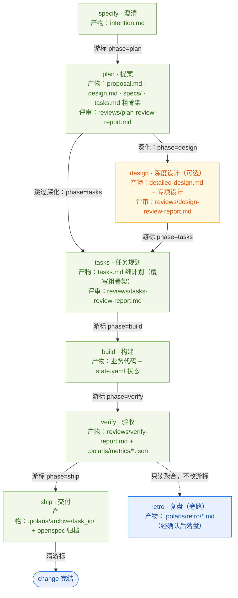

### 阶段-技能-产物对照

| 游标 phase | 技能 | 中文名 | 主产物 | 评审报告 |
|-----------|------|--------|--------|----------|
| `specify` | `specify` | 澄清 | `openspec/changes/<id>/intention.md` | — |
| `plan` | `plan` | 提案 | `proposal.md`、`design.md`、`specs/`、`tasks.md`（粗骨架） | `reviews/plan-review-report.md`（+ 可选 `reviews/openspec-review-report.md`） |
| `design`（可选） | `design` | 深度设计 | `detailed-design.md` 及专项设计（`data-model-design.md` / `restful-api-design.md` 等） | `reviews/design-review-report.md` |
| `tasks` | `tasks` | 任务规划 | `tasks.md`（细计划） | `reviews/tasks-review-report.md` |
| `build` | `build` | 构建 | 业务代码 + `.polaris/tasks/<id>/state.yaml` | `reviews/code-review-report.md`（按 `review_mode`） |
| `verify` | `verify` | 验收 | `reviews/verify-report.md` + `.polaris/metrics/<ts>-metrics.json` | 同上 |
| `ship` | `ship` | 交付 | `.polaris/archive/<id>/`、`openspec/changes/archive/` | — |
| `retro`（旁路） | `retro` | 复盘 | `.polaris/retro/<UTC>-report.md` | — |

**入口阶段**：`specify` 由入口命令显式进入，不走 `state next`（阶段表中 `skill: null`）。
**旁路阶段**：`retro` 只出现在 `state.yaml`，不属推进游标主序列，也不计入进度分母。

---

## 3. 通道内部流程

`tweak` 与 `normal` 把多段流程压缩进**一个技能**，因此技能内部不推游标 —— 全程只有出口那一次写入。

### 3.1 tweak（快速通道）

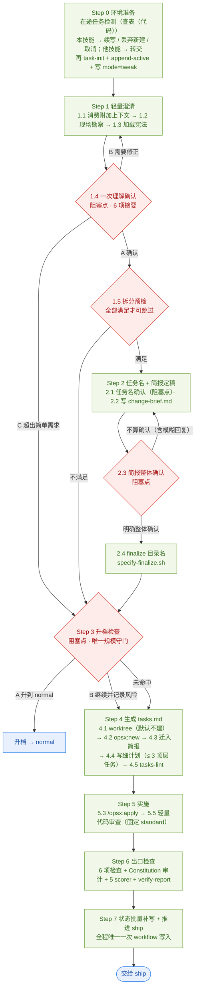

**三处人工确认（阻塞点）**：1.4 理解确认、2.1 任务名、2.3 简报定稿。
**升档出口三个**：1.4 选 C（无制品，成本为零）、1.5 拆分预检不通过、Step 3 升档检查命中。
**刻意不做**：worktree 询问、TDD 策略询问、执行方式询问、审查模式询问、独立设计、阶段主审。TDD 由 `tweak-tasks-template.md` 规则逐任务自动标注。

### 3.2 normal（常规通道）

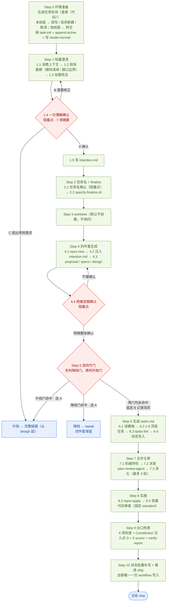

**三处硬阻塞点**：1.4 理解确认、2.1 任务名、4.4 规格定稿确认。
**Step 5 双向守门是 normal 的核心机制** —— 位置固定在规格定稿之后、`tasks.md` 生成之前，此刻制品只有 `intention.md` + 四件套，两个方向的转交成本都为零：

| 门 | 命中条件 | 选项 | 转交动作 |
|----|----------|------|----------|
| 降档门（→ tweak） | 命中 tweak 档全部判定条件（单模块 / ≤ 1 delta spec / ≤ 3 顶层任务可覆盖 / 无接口契约与数据实体变更） | A 降到 tweak / B 继续 normal 并记录 | 保留四件套与 `intention.md`，游标保持 `plan` 不动 |
| 升档门（→ 完整链路） | 命中任一完整链路信号（跨服务 / 需专项设计 / 数据迁移 / 破坏性契约变更 / 顶层任务 > 8 / 需求不稳 / 高危领域） | A 升到完整链路 / B 继续 normal 并记录 | 四件套已在，游标推 `phase=design` |
| 双门同时命中 | 概率极低 | — | 以**升档门优先**呈现 |

> **Step 7 合并主审**是 normal 相对 tweak 的核心加法，复用 `plan-review-agent`，评审对象天然是四件套 + `intention.md`。主审 `BLOCK` 或存在未消化 Critical → 禁止进 Step 8，最多重跑 3 轮。

---

## 4. 完整链路各技能内部流程

以下 8 个技能中，前 7 个（`specify` → `plan` → `design`? → `tasks` → `build` → `verify` → `ship`）构成完整链路，各自独立占一个游标阶段；`retro` 为旁路，不占游标。

> `specify` 是**入口阶段**（阶段表 `skill: null`），由入口命令显式进入，不走 `state next`；其余 6 个由上一阶段出口推进游标后衔接。

### 4.1 specify（澄清）

```mermaid
flowchart TD
    S0["Step 0 设置产物语言<br/>读 .polaris/config.yaml 的 language"]
    S0 --> S1["Step 1 准备 draft 目录 + workflow entry<br/>在途任务检测（查表（代码））→ 本技能继续 / 他技能转交<br/>task-init → 1.2 append-active → 1.3 写 workflow.mode=strict"]
    S1 --> SC1{"存在未完成 draft 时的处置<br/>阻塞点"}
    SC1 -->|"C 丢弃所有后重建"| S1
    SC1 -->|"A 续写最近 / B 指定一个"| S2["Step 2 加载宪法（注入点 A）"]
    S2 --> S30["Step 3.0 探索想法与需求澄清<br/>openspec-explore + 提问 ≥3 个 / 覆盖 ≥3 类"]
    S30 --> S31["Step 3.1 需求拆分预检<br/>阻塞点"]
    S31 --> S32["Step 3.2 Reframe Check<br/>✅ / ✏️（≤2 轮）/ ❌"]
    S32 --> S33["Step 3.3 决策方案 Options<br/>2–3 个方案 + 优劣权衡"]
    S33 --> S34["Step 3.4 Premise Challenge<br/>3–5 条前提全部认可"]
    S34 --> S41["Step 4.1 任务名称确认<br/>阻塞点 → task_id"]
    S41 --> S42["Step 4.2 写 intention.md（仍在 draft 目录）<br/>首行直接写真实 task_id"]
    S42 --> S51["Step 5.1 意图评审（人工）"]
    S51 --> S52{"Step 5.2 意图 Lint<br/>intention-validate.sh"}
    S52 -->|"exit 1 · 修正后重跑"| S42
    S52 -->|"exit 0"| S53{"Step 5.3 全文整体确认<br/>阻塞点"}
    S53 -->|"不算确认 · 重跑 5.2"| S52
    S53 -->|"明确整体确认"| S54["Step 5.4 finalize<br/>5.4.1 分级初判 complexity / risk / current_tier"]
    S54 --> S55["Step 5.5 游标推进 → phase=plan"]
    S55 --> SNEXT(["交给 plan"])

    classDef step fill:#f1f8e9,stroke:#689f38,color:#33691e
    classDef gate fill:#fdecea,stroke:#d93025,color:#a50e0e
    classDef out fill:#e8f0fe,stroke:#1a73e8,color:#174ea6
    class S0,S1,S2,S30,S31,S32,S33,S34,S41,S42,S51,S52,S54,S55 step
    class SC1,S53 gate
    class SNEXT out
```

**三处阻塞点**：draft 处置（Step 1）、任务名（4.1）、全文确认（5.3）。
**特有点**：Step 3 是唯一带「提问下限」的步骤（≥3 问 / ≥3 类，模糊回答不计入）；5.4.1 分级初判只落档位、不代决通道，通道决策留给 `normal` Step 5。

### 4.2 plan（提案）

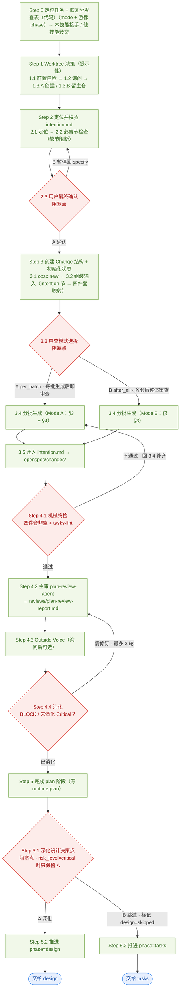

**plan 是唯一有两个出口阶段的技能**：A 深化 → `design`，B 跳过 → `tasks`。
**Mode A / B 的差别**：A 在分批生成时即逐批审查并冻结（`review-log.md`），Step 4.2 再做齐套跨批 Verdict；B 跳过批内审查，Step 4.2 是唯一制品主审出口。

### 4.3 design（深度设计）

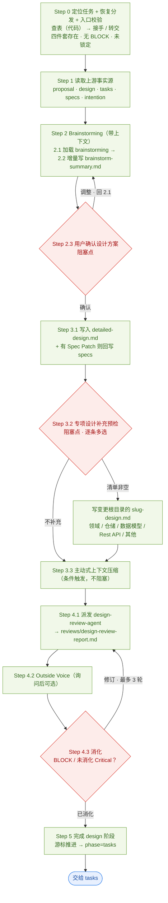

**职责边界**：深化 ≠ 替代 —— 禁止重写 `proposal.md` / 高层 `design.md` / `tasks.md` 的范围，缺口只能以 Spec Patch 回写 `specs/`。
**专项设计**：文件名必须为 `<slug>-design.md` 且落在变更根目录（扁平），禁止命名为 `design.md`、禁止子目录。

### 4.4 tasks（任务规划）

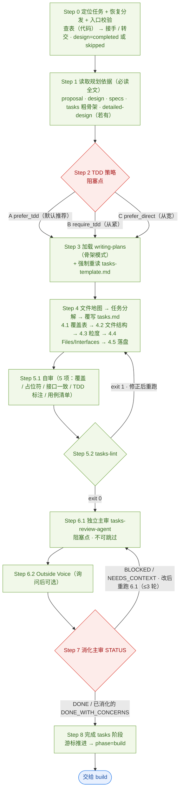

**与 plan / design 的关键差异**：主审**不可跳过**（`PLATFORM_DEGRADATION=inline|unsupported` 时直接阻断，不放行到 build）。
**TDD 策略决定的是子步骤形态**：`TDD 任务` = 用例清单 + 5 步，`非 TDD 任务` = 3 步；build 严格按标注执行，不得用全局开关覆盖。

### 4.5 build（构建）

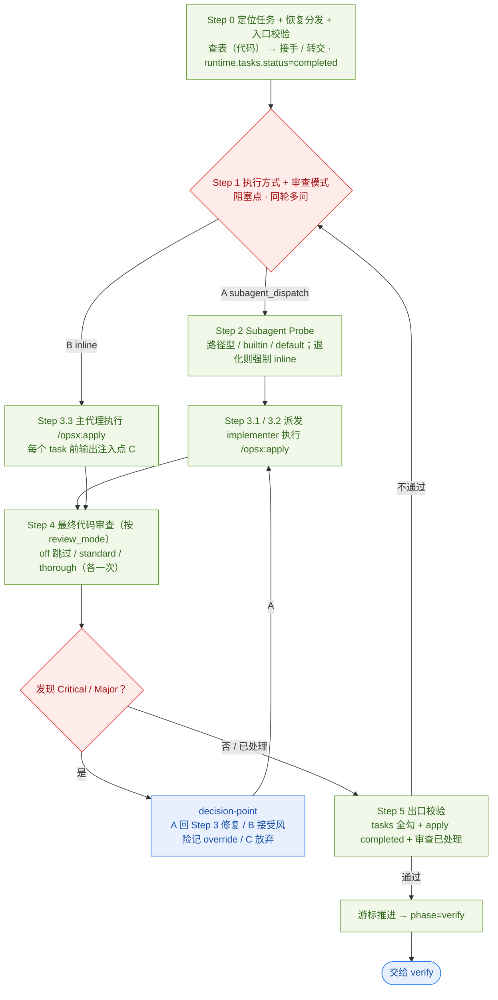

**apply 的唯一性**：业务实现代码只能在 `/opsx:apply` 内产生，禁止在 apply 之外手写。
**与 verify 去重**：Step 4 审过的 diff，verify 侧只聚焦「是否符合 spec/tasks」与「build 之后的新增改动」。

### 4.6 verify（验收）

`verify` 是 coding 族步骤最多的技能（17 步），按三段组织：

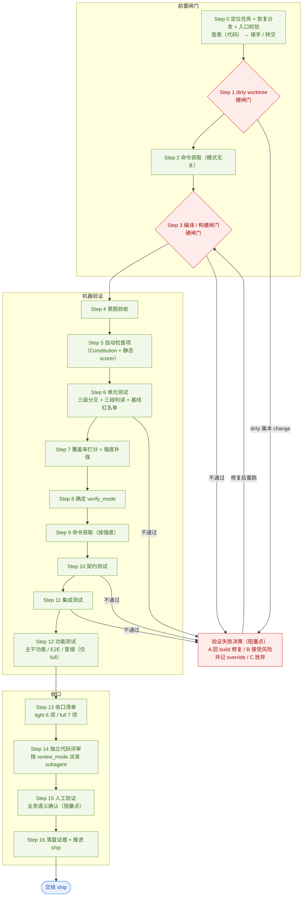

#### verify_mode 与相关取值

| 取值 | 决定位置 | 含义 |
|------|----------|------|
| `verify_mode` ∈ `light` / `full` | Step 8 | 验证强度。基础档由规模启发式给出，再由 `score_level` 补强，`risk_level=critical` 时一票升 `full` |
| `risk_level` ∈ `trivial` / `standard` / `critical` | 两轴复核 | **只升不降**；降到更低值必须由用户显式确认 |
| `review_mode` ∈ `off` / `standard` / `thorough` | `build` Step 1.2 | 决定 Step 14 是否派发独立代码评审、用哪种覆盖面 |
| `build_mode` ∈ `inline` / `subagent_dispatch` | `build` Step 1.1 | 决定 `/opsx:apply` 在主会话还是 implementer subagent 内执行 |

> `verify_mode` 的**唯一读取来源**是 `runtime.verify.verify_mode`。`state.yaml` 顶层的 `verify_mode` 是历史遗留死值，禁止读取。

### 4.7 ship（交付）

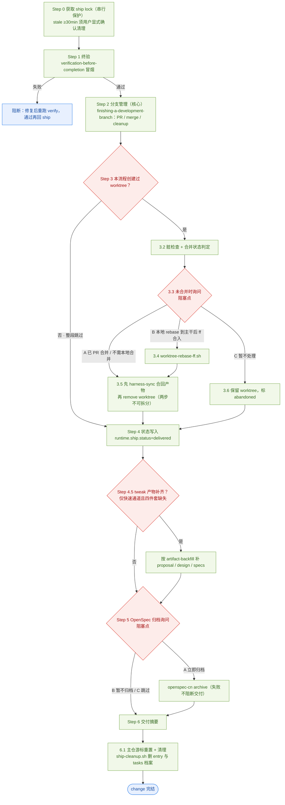

**Step 0 的锁**：`ship` 是唯一带串行保护的技能（`.polaris/.locks/ship.lock`）。
**3.5 的不可拆分**：必须先 `harness-sync` 合回产物、再 `git worktree remove`；顺序反了会丢 `.polaris/` 产物。

### 4.8 retro（复盘）

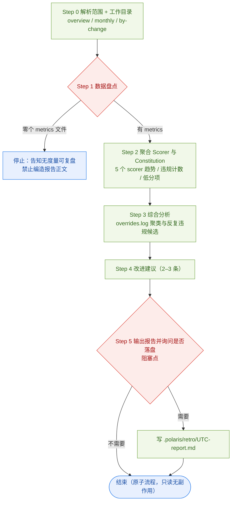

**retro 与其他 7 个技能的三点不同**：

1. **不写游标** —— 阶段表登记 `skill: null`，不由任何技能的「自动衔接下一阶段」进入，也不进任何技能的下游；
2. **原子流程** —— 中间不设恢复点，中断即重跑（metrics 是只读输入，重跑无副作用）；
3. **报告默认不落盘** —— 经决策点询问后才写 `.polaris/retro/<UTC>-report.md`。

---

## 5. 人工确认（阻塞点）总览

所有阻塞点都走 `assets/zh/policies/decision-point.md`：**只有一个安全下一步时不得制造确认**。

| 技能 | 位置 | 确认内容 | 选项数 |
|------|------|----------|--------|
| `tweak` / `normal` / `specify` | Step 0 / 1 | **在途任务检测**（查表（代码）；判定为**本技能**才进入本决策点，**他技能**直接转交、不询问） | 3（续写 / 丢弃并新建 / 取消） |
| `tweak` | Step 0 | 存在未完成 draft 时的处置 | 4（A 续写 / B 选择 / C 丢弃重建 / D 退出） |
| `tweak` | 1.4 | 理解摘要（6 项） | 3（确认 / 修正 / 升档） |
| `tweak` | 2.1 | 任务名 | 2–3 推荐名 + 自填 |
| `tweak` | 2.3 | 简报整体定稿 | 确认 / 反馈 |
| `tweak` | 3 | 升档检查命中 | 2（升 normal / 继续并记录） |
| `normal` | 1.4 | 理解摘要（7 项） | 3（确认 / 修正 / 升档） |
| `normal` | 2.1 | 任务名 | 2–3 推荐名 + 自填 |
| `normal` | 4.4 | 规格四件套定稿 | 确认 / 反馈 |
| `normal` | 5 | 双向守门命中 | 升 / 降 / 继续并记录 |
| `normal` | 7 | 合并主审无法派发时 | 2（接受跳过并记录 / 阻断） |
| `specify` | 3.1 | 需求拆分预检 | 按预检结论 |
| `specify` | 4.1 | 任务名 | 2–3 推荐名 + 自填 |
| `specify` | 5.3 | `intention.md` 整体确认 | 确认 / 反馈 |
| `plan` | 4 | 提案整体评审（阻塞点） | 确认 / 反馈 |
| `plan` | 4.3 | Outside Voice 复杂度建议 | 2（启动 / 跳过） |
| `plan` | 5.1 | 是否深化设计 | 2（深化 / 跳过）；`risk_level=critical` 时**只保留深化** |
| `design` | 2.3 | 设计方案确认 | 确认 / 调整 |
| `design` | 3.2 | 专项设计补充预检（多选） | 逐条多选 + 不补充 + 自定义 |
| `design` | 4 | 设计评审（阻塞点） | 消化 / 修订 |
| `tasks` | 2 | TDD 策略 | `prefer_tdd` / `require_tdd` / `prefer_direct` |
| `tasks` | 6 | 独立主审（`tasks-review-agent`） | 阻塞点 |
| `build` | 1 | 执行方式 + 审查模式（同轮多问） | `build_mode` 2 项 / `review_mode` 3 项 |
| `verify` | 4 | 意图验收确认 | 两槽一次展示、一次确认 |
| `verify` | 各闸门与检查项触发（全局决策点） | 验证失败 / override / 规格漂移决策 | A 回 build / B 接受风险并记 override / C 放弃 |
| `verify` | 15 | 人工业务语义确认 | 必现（light / full 都要） |
| `ship` | 3.3 | worktree 未合并时 | 3（已 PR 合并 / 本地 rebase-ff / 暂不处理） |
| `ship` | 5.1 | 是否归档 | 3（立即归档 / 暂不归档 / 跳过） |
| `retro` | 5 | 复盘报告是否落盘 | 2（需要 / 不需要） |

**共同规则**：明确整体确认才算确认；只对某条反馈、模糊回复（「差不多」「可以吧」）、沉默一律**不算确认**，必须重新发问。

---

## 6. 状态与游标约定

进度判断只有一套机制：`.polaris/workflow.yaml` 的**游标**。

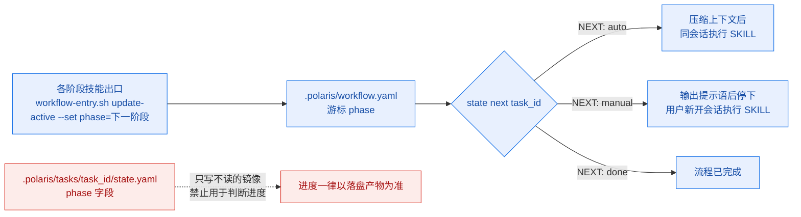

### 游标写入点

| 技能 | 写入时机 | 写入值 |
|------|----------|--------|
| `intake` | — | **不写游标**（受理入口，只读游标做恢复分发） |
| `specify` | Step 1（建条目）；Step 5 出口 | `append-active` → `phase=specify`；随后推 `phase=plan` |
| `plan` | Step 5.2 出口 | `phase=design`（深化）或 `phase=tasks`（跳过深化） |
| `design` | 出口 | `phase=tasks` |
| `tasks` | 出口 | `phase=build` |
| `build` | 入口 `enter-phase`；出口 | `phase=build`；出口推 `phase=verify` |
| `verify` | 出口 | `phase=ship` |
| `ship` | 出口 | 清游标 |
| `tweak` | Step 0（建条目）；出口 | `append-active` → `phase=specify`；出口推 `phase=ship` |
| `normal` | Step 0（建条目）；出口 | 同上 |
| `retro` | — | **不写游标**，只读聚合 |

> **建条目（`append-active`）与推 phase（`update-active`）是两件事**：`task-init` 只建目录、**不写游标**，
> 由 `specify` / `normal` / `tweak` 各自的 Step 0/1 建条目（`phase=specify`），之后才由各阶段技能出口推进 phase。
> 缺建条目 → 后续 `update-active` / `rename-active` 会以 **exit 3** 阻断（找不到 entry）。
>
> **通道迁移（升/降档）除推 phase 外，还必须改写 `state.yaml` 的 `workflow.mode`**（写成目标通道）——
> 否则恢复分发的代码表会把该任务判回原通道，接手方找不到它（见 §1.1 的 `skillForModePhase`）。

### 恢复清单四件

任何写「恢复清单」的地方只写这四件：

1. **任务身份**：`task_id` 与产出目录
2. **进度依据**：读哪个落盘产物判断做到哪 —— 不要读 `state.yaml.phase`
3. **上一段产出**：本技能最近一次落盘的文件与字段
4. **起始步骤**：从本技能的哪个 Step 继续

> **`state.yaml` 只记身份与指针、不记进度** —— 进度一律以落盘产物为准（产物即状态）。

---

## 7. 通用约束

| 约束 | 内容 |
|------|------|
| H8 | 每个 Step 入口输出可见状态行 |
| H10 | subagent 派发前必须 probe；优先读 SessionStart 注入与 `$SUBAGENT_PROBE_CACHE`，`inline` / `unsupported` 时不派发 |
| H12 | 写 `.polaris/workflow.yaml` 一律走 `scripts/workflow-entry.sh`（内含 lock 与写后校验） |
| H13 | 不调用两个 superpowers 派发驱动器 |
| H14 | 开发类（C01–C03）的需求预检由 `polaris:coding:intake` 的 Step 1 把关（命令层不再预检）；M01 / M02 **不经** `intake`，由 `polaris:debug:diagnose` 校验补全 |
| Constitution 注入 | 注入点 A（澄清期加载）、C（每个 task 实施前输出适用原则）、D（出口合规审计） |
| TDD | Test-First 是 Constitution NON-NEGOTIABLE；三档都**不询问**全局开关，按任务类型逐任务自动标注 |

**TDD 自动标注规则**（`tweak` / `normal` 共用）：

- 新功能 / Bug 修复 / 含分支逻辑 → `<!-- TDD 任务 -->`（5 步）
- 配置修改 / 重命名 / 文档更新 / 依赖升级 / 构建脚本 / 脚手架 → `<!-- 非 TDD 任务 -->`（3 步）
- 无法判定 → **默认 TDD**
