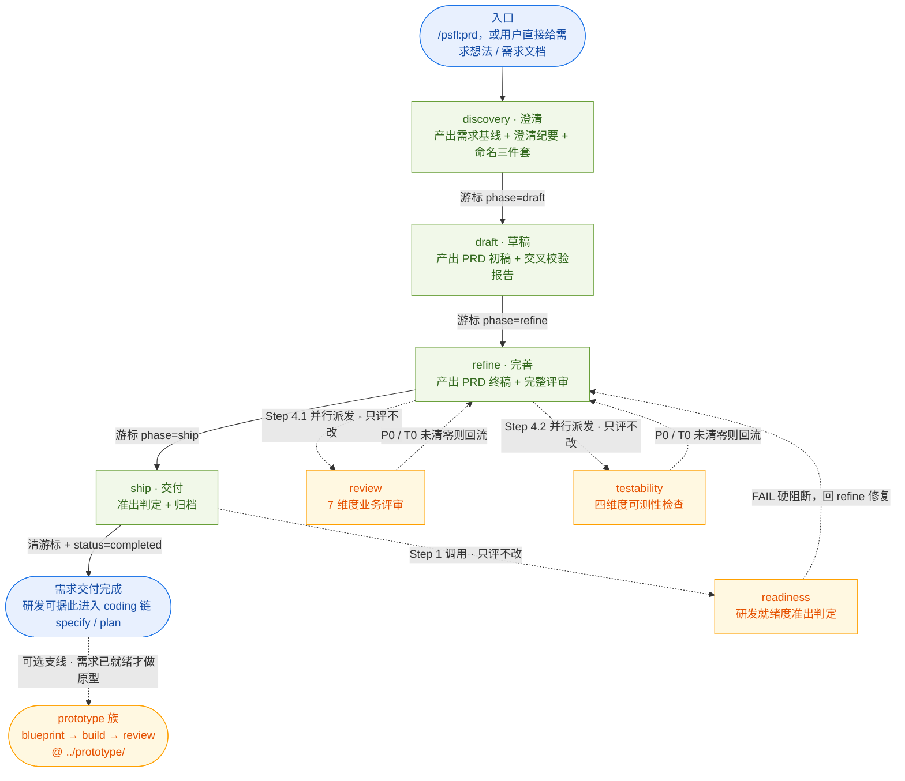
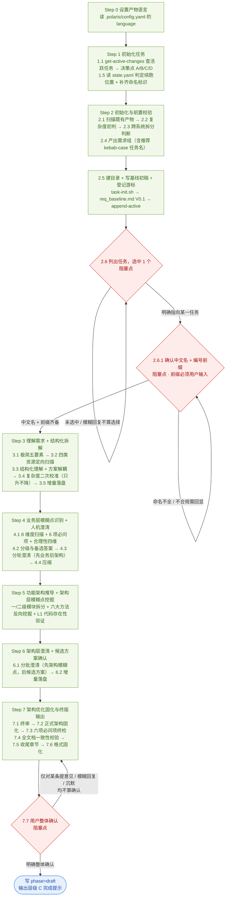
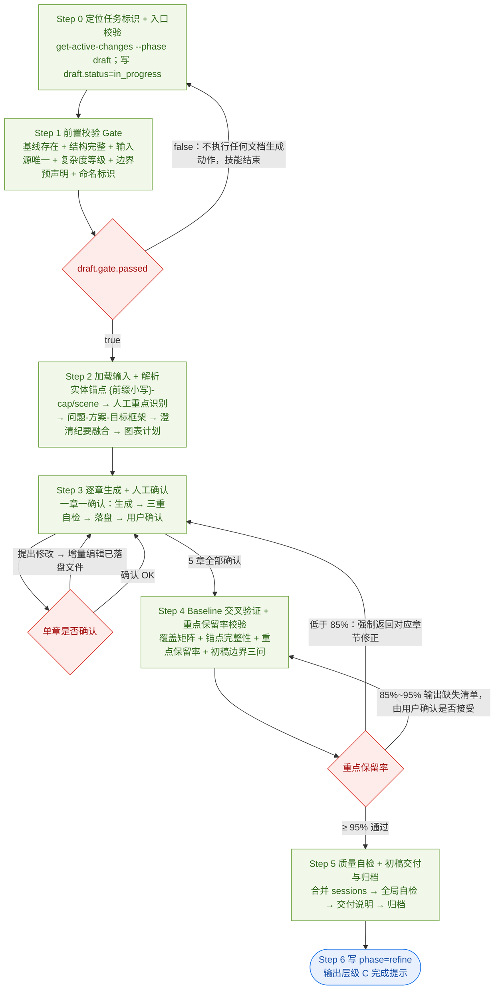
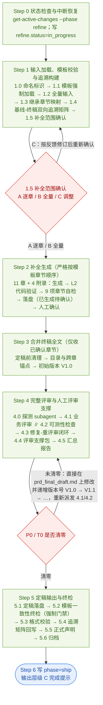
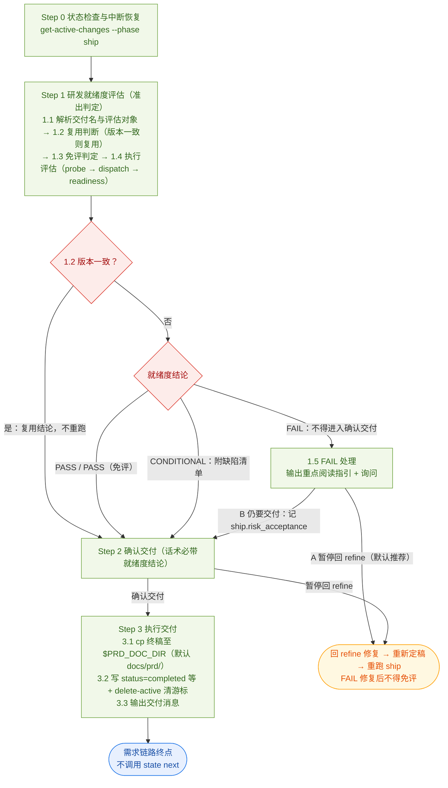
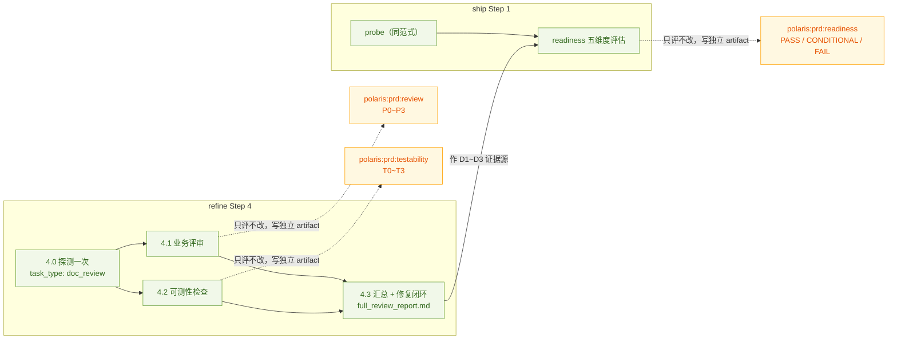
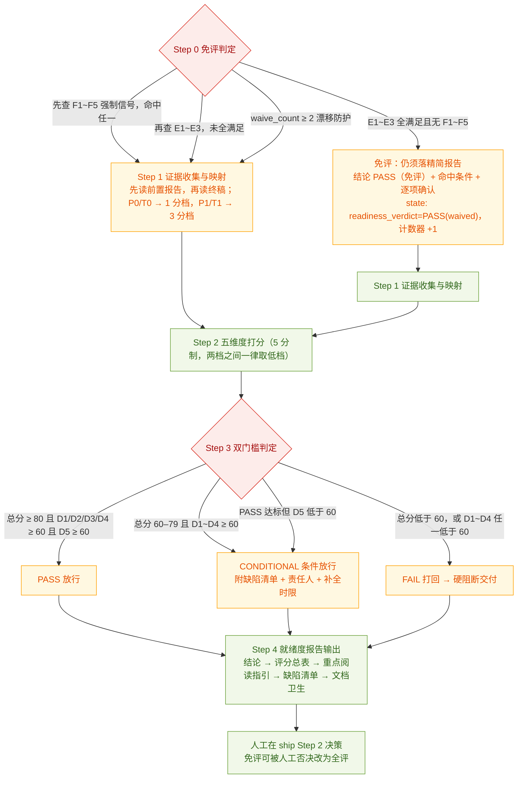
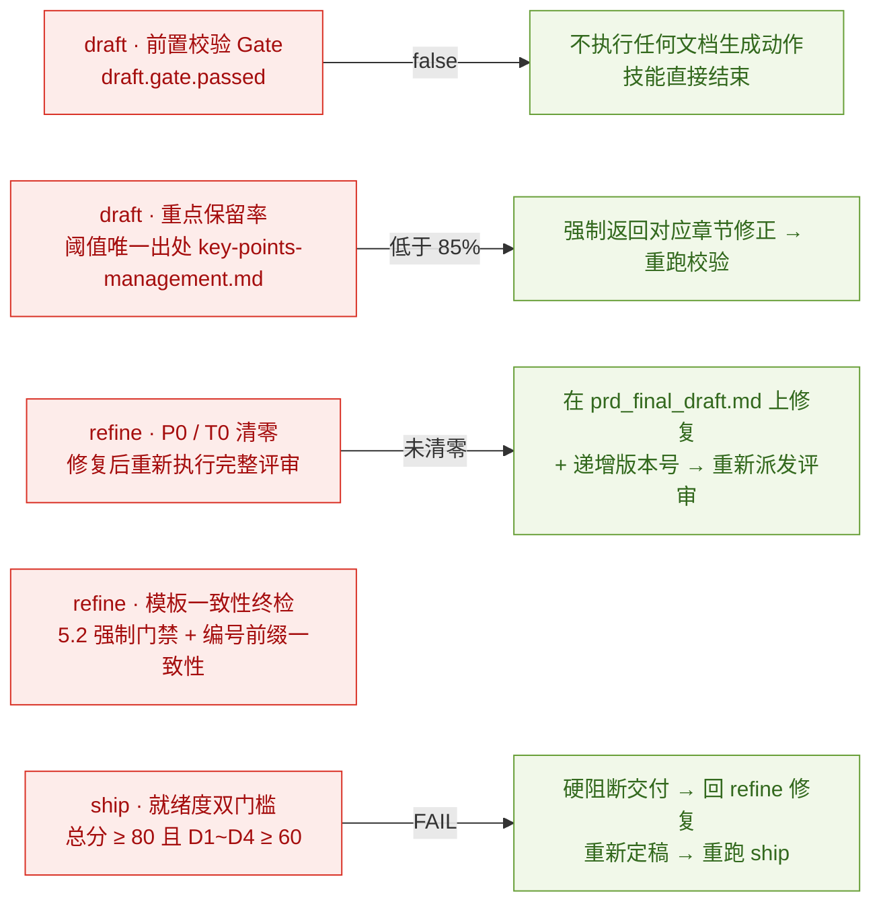

# PRD（需求工程）工作流技能流程图

> 本文档描述 `assets/zh/skills/prd/` 下 7 个技能的组织方式与流转关系。
>
> **权威源**（本文档与它们冲突时以它们为准）：
>
> | 内容 | 唯一来源 |
> |------|----------|
> | 阶段序列、各阶段产物、初始 phase、state 模板 | `src/core/config/task-kind-layout.ts` 的 `kind: 'requirement'` 条目 |
> | 各技能内部步骤 | 各技能目录下的 `SKILL.md` |
> | 阶段衔接方式（manual / auto） | `assets/zh/policies/auto-transition.md` |
> | 人工确认协议 | `assets/zh/policies/decision-point.md` |
> | 复杂度评分与升档 | `assets/zh/skills/prd/discovery/policies/complexity-assessment-policy.md` |
> | 产物布局的人读概览 | `assets/zh/skills/prd/README.md`（**概览，非裁定依据**；本文档 §8 列出其与权威源的偏差） |
>
> 文档不含菜单编号（C/M/R/P/T 前缀码属命令层 UI 概念，技能层不引用）。
>
> 本文档与 `coding-workflow-flows.md` 同构：前者描述 `kind: 'coding'`，本文档描述 `kind: 'requirement'`。

---

## 1. 总览：主链路 + 服务型技能 + 下游

PRD 技能族不是一条带分支的流水线，而是**一条严格串行的主链路**、**三个被调度的服务型技能**、以及**一条下游侧支线**。

三条结构性规则：

1. **主链路严格串行、无跳档**：`discovery → draft → refine → ship`，四个阶段各自写一次 workflow 游标，中间不合并、不并行。
2. **服务型技能不进相位表**：`review` / `testability` / `readiness` 不是阶段、不推游标，由上游技能内部以 subagent 派发（可为平台降级为主代理内联），也可被用户独立触发。
3. **判定者与执行者分离**：文档质量由 `refine` 保证（P0/T0 清零），**能否交付研发进入技术设计**由 `ship` 调用 `readiness` 独立判定。P0/T0 清零 ≠ 可交付研发。

---

## 2. 阶段 / 技能 / 产物 / 游标 对照

| 游标 phase | 技能 | 中文名 | UI 分组 | 主产物 | 该阶段的服务型技能 |
|-----------|------|--------|---------|--------|--------------------|
| `discovery` | `discovery` | 澄清 | 澄清与草稿 | `.polaris/tasks/<id>/req_baseline.md`、`req_clarify_summary.md` | — |
| `draft` | `draft` | 草稿 | 澄清与草稿 | `.polaris/tasks/<id>/prd-draft.md`、`_baseline_index.json`、`_key_points.json` | — |
| `refine` | `refine` | 完善 | 完善与交付 | `.polaris/tasks/<id>/prd-final-v1.0.md`、`final/full_review_report.md`、`final/review-package/` | `review` + `testability`（Step 4.1 / 4.2 并行） |
| `ship` | `ship` | 交付 | 完善与交付 | 交付文档 `{前缀}-{中文名}-需求终稿-v1.0.md` 迁入 `docs/prd/`、`final/readiness_report.md` | `readiness`（Step 1 调用） |

**入口阶段**：`discovery` 由入口命令显式进入，阶段表中 `skill: null`，不走 `state next`。
**游标写入点**：`discovery` 出口写 `phase=draft` → `draft` 出口写 `phase=refine` → `refine` 出口写 `phase=ship` → `ship` 出口 `delete-active` 清游标并把任务置 `status=completed`。
**其他初始化**：`storageSegment: tasks`（复数）、`usesDraft: false`（需求任务**不**创建 `draft-*` 临时目录，须直接给正式 `task_id`）、state 模板 `prd-state.example.yaml`。

---

## 3. 主链路各阶段内部流程

### 3.1 discovery（澄清）

**复杂度三档联动**（初判在 2.2，二次校准在 3.4，写入基线元数据后被 `draft` / `refine` 消费）：

| 等级 | 模糊点扫描 | 合理性校验 | 澄清交互模式 | 架构输出 |
|------|-----------|-----------|-------------|---------|
| 简单 | 核心 3 维度 | 业务合理性单点 | 单轮批量提交 | 单层功能清单 |
| 标准 | 全量 8 维度 | 业务 / 技术 / 合规 / 成本 | 高-中-低分 3 轮 | 双层架构 + 依赖 |
| 复杂 | 全量 8 维度 | 全量 | 强制**单轮单问** | 双层架构 + 能力引用矩阵 + 规则 ID |

**命名三件套**（Step 2.6.1 产出，全链路复用）：`task_id`（kebab-case 目录名）、**需求中文名**（4–12 汉字）、**需求编号前缀**（大写 ASCII 2–16 位，**必须用户输入**，AI 不派生、不默认填充）。前缀一经确认全程不变，变更视同需求变更。

### 3.2 draft（草稿）

- 章节顺序固定：`01-需求背景` → `02-业务流程与时序` → `03-需求详情-通用能力层` → `03-需求详情-业务场景层` → `04-版本记录`（5 个文件、4 个章节）；文档头部（评审重点指引）在合并阶段统一生成。
- 复杂度联动裁剪：图表深度、风险清单条数、MoSCoW 严谨度、边界声明详尽度四维按 简单/标准/复杂 分档。
- **本阶段不评审业务合理性**，只校验「有没有写、重点是否保留、引用是否合法、边界是否合规」。

### 3.3 refine（完善）

**关键结构事实**：

- **唯一结构真源** = `./templates/prd_template.md`（11 章 + 4 附录）。禁止偏离章节顺序、命名与子结构。
- **Step 4 起，`final/prd_final_draft.md` 成为唯一真源**：分章文件冻结不再回写，评审修复一律直接落在全文并递增版本号 —— 因此不存在「分章文件与终稿漂移」。
- **Step 5.1 不重复拼接**：直接复用 Step 3 产物，落盘为任务内固定名 `prd-final-v1.0.md`（文件名中的 `v1.0` 只是脚本定位标识，与文档内部版本号解耦）。
- **L2 代码验证**（有 `coding-knowledge` 时）：术语枚举 / 第 4 章数据模型 / 状态枚举与真实代码对齐，不一致以代码为准；无知识库则降级 L1 设计级并标注「开发前需技术复核」。
- 章节来源：继承增强（一 概述、二 角色与权限、三 业务流程与用户旅程、五 功能需求）；新增生成（四 数据模型、六 规则汇总、七 状态流转、八 非功能、九 依赖与约束、十 验收与度量、十一 风险与开放问题）。

### 3.4 ship（交付）

- **交付文档名在迁移时生成**：任务内固定名 `prd-final-v1.0.md` → 交付名 `{前缀}-{中文名}-需求终稿-v1.0.md`（便于从文档库文件名反查需求与编号命名空间）。
- **目标文件已存在（exit 3）不得静默覆盖**：按决策点询问 覆盖 / 另存为 `-v1.1` / 取消交付。
- `ship` 是链路终点：Step 3.2 已 `delete-active`，**不调用** `state next`。

---

## 4. 服务型技能

### 4.1 编排关系

三个服务型技能共享同一套编排范式：**probe 能力探测 → 选定 agent → dispatch 派发 → 消费 `result.artifact_path`**；平台不支持 subagent 时**自动降级为主代理 inline 执行**，并在报告中标注「由主代理内联评审」。

- **并行约束**：4.1 与 4.2 共用**同一次** probe 结果、可并行派发，但 `materials` 中的 PRD 终稿路径**必须指向同一文件**；全文被修订时须先修订再重新派发，禁止两个 subagent 评审不同版本。
- **一方 inline 降级不阻塞另一方**，各自独立落盘；汇总时按「业务评审」+「可测性检查」两节组织，某维度未能执行只标注、不阻塞另一维度。
- **subagent 禁止把报告正文贴回**：只回报 `artifact_path`，正文由主代理读文件写入汇总报告。

### 4.2 review（7 维度业务评审）

`Step 1 输入加载与范围确认 → Step 2 七维度逐项评审 → Step 3 问题汇总与分级 → Step 4 报告输出与重评审机制`（Step 1–4 为原子流程，中断即从 Step 1 重跑）。

| 维度 | 名称 | 主要检查目标 |
|:--:|------|-------------|
| 1 | 业务一致性 | 功能需求能否支撑业务目标；角色、场景、术语是否对齐 |
| 2 | 范围完整性 | 基线需求是否全覆盖；是否有需求蔓延；功能点五要素是否完整 |
| 3 | 逻辑自洽性 | 流程闭环、状态流转一致、规则无矛盾、事务与并发 |
| 4 | 规则明确性 | 无模糊表述、可判定、条件/枚举/默认值/计算/时效完整、`{前缀}-BR-XXX` 唯一 |
| 5 | 可实现性 | 架构兼容、第三方依赖、性能可达、数据可得、风险与依赖排序 |
| 6 | 合规性 | 权限控制、数据安全、审计留痕、数据保留、导出控制 |
| 7 | 基线双向一致性 | 正向覆盖 + 反向追溯 + 意图/优先级/范围边界一致 + 命名编号一致 |

分级：**P0 阻塞**（必修，修后重评审）/ P1 重要（建议修，不修须记风险与接受理由）/ P2 一般（可选）/ P3 待确认（列入终稿 11.2）。
报告采用**双视图**：检查过程视图（按维度）+ 处理决策视图（按 P0~P3），问题 ID 两处配对、锚点互链。

### 4.3 testability（四维度可测性检查）

`Step 1 加载并建立可测性基线 → Step 2 四维度检查 → Step 3 汇总与验收标准补全建议 → Step 4 报告`。

| 维度 | 名称 | 判据要点 |
|:--:|------|---------|
| 1 | 验收标准完整性 | 每功能点有验收标准、可验证、覆盖正常场景，采用 **GWT（Given/When/Then）** 格式 |
| 2 | 业务规则可判定性 | 触发条件、边界值、枚举、例外、优先级、计算逻辑、时效可量化，规则编码可引用 |
| 3 | 场景覆盖充分性 | 正常 / 异常（7 类标准异常）/ 边界（数值、数量、空数据、极值）三类全覆盖 |
| 4 | 数据指标可验证性 | 指标定义、统计口径、目标值、验证方法、数据来源、统计周期明确 |

分级 **T0~T3**；T0/T1 须逐条给出 GWT 格式的补全建议。报告另输出 A/B/C/D 评级（覆盖率 + 可判定率 + T0 数量）。

### 4.4 readiness（研发就绪度准出判定）

回答一个且仅一个问题：**这份 PRD 现在交给研发，能不能开工做技术方案设计？**

**五维度权重**（权重含义 = 该维度缺失时研发返工/阻塞的代价，不是写作重要性）：D1 需求覆盖与可追溯 16% ｜ D2 准确性与内部一致性 16% ｜ D3 无歧义与可判定 22% ｜ **D4 技术设计支撑度 33%** ｜ D5 不确定性与风险管理 13%。
**D4 单独细化**：按 5 个子项等权打分（字段级数据模型 / 报文级接口契约 / 状态机与流转 / 事务·并发·幂等 / NFR 量化），避免「数据模型满分但状态机缺失」被平均成 3 分蒙混过关。
**免评的三条防线**：E1~E3 全满足才免评（黑名单式）；F1~F5 命中任一即全评（首次交付必须全评）；连续免评 2 次后第 3 次强制全评。**豁免的是评估动作，不是准出判定** —— 免评仍须落结论与审计记录，人工可当场改为全评。

---

## 5. 门禁与回流

**门禁口径汇总**：

| 门禁 | 位置 | 判定 | 不通过的后果 |
|------|------|------|-------------|
| 前置校验 Gate | draft Step 1 | 基线存在 + 结构完整 + 输入源唯一 + 复杂度可读 + 命名齐备 | 不生成任何文档，写 `draft.gate.passed=false` 后结束 |
| 重点保留率 | draft Step 4 | ≥ 95% 通过；85%~95% 由用户确认；< 85% 强制返回修正 | 回 Step 3 对应章节修改后重跑校验 |
| 模板一致性终检 | refine Step 5.2 | 章节数量/标题/顺序/子结构/表格格式与模板完全一致 + 编号前缀一致 | 修正后才能输出（强制门禁） |
| 阻塞问题清零 | refine Step 4.3 | P0 / T0 必须清零 | 修复 → 递增版本号 → 重新派发评审，迭代至清零 |
| 就绪度双门槛 | ship Step 1（readiness） | 总分 ≥ 80 且 D1/D2/D3/D4 ≥ 60（D5 < 60 强制降级） | FAIL 硬阻断：只提供「暂停回 refine」，不提供「确认交付」 |

---

## 6. 人工确认（阻塞点）总览

| # | 阶段 | 位置 | 确认什么 | 不算确认的情形 |
|:--:|------|------|---------|---------------|
| 1 | discovery | Step 1.1 | 存在活跃任务时选 A 继续 / B 选择 / C 丢弃 / D 取消 | — |
| 2 | discovery | Step 2.6 | 从任务清单中**明确选中 1 个**继续推进 | 「都要做」「按建议来」「先做重要的」；只确认清单本身 |
| 3 | discovery | Step 2.6.1 | 需求中文名（3 候选或自拟）+ 编号前缀（**用户输入**） | 只给其中一项；前缀不合规须回显再确认 |
| 4 | discovery | Step 7.7 | 整体确认《需求基线》+《需求澄清纪要》 | 仅对某条/某节反馈；「差不多」「可以吧」；沉默 |
| 5 | draft | Step 3 | **逐章确认**（一章一确认，5 章） | 未确认不得进入下一章；修改意见 → 增量编辑后重新确认 |
| 6 | draft | Step 4 | 缺失功能/重点项：补充到 PRD ｜ 该条目废弃 | — |
| 7 | refine | Step 1.5 | 补全范围与验证级别：A 逐章 / B 全量 / C 调整 | — |
| 8 | refine | Step 2 | **逐章确认**（11 章 + 4 附录；或全量生成后一次性确认） | 未确认章节不进 Step 3 合并 |
| 9 | refine | Step 4.3 | 修复后重新提交确认 | — |
| 10 | ship | Step 1.5 | FAIL 后：A 暂停回 refine ｜ B 仍要交付（须填风险接受理由） | 默认只推荐 A |
| 11 | ship | Step 2 | 确认交付（PASS / PASS（免评） / CONDITIONAL 三种话术） | 免评时人工可改为全评 |
| 12 | ship | Step 3.1 | 目标文件已存在：覆盖 ｜ 另存为 `-v1.1` ｜ 取消交付 | 不得静默覆盖 |

**发问方式**：一律按 `assets/zh/policies/decision-point.md` 暂停、按 `ask-question-react.md` 发起封闭式询问（工具名经平台注册表查得，**禁止在技能内写死**）；单次选项上限以该注册表为准，超出时分组两级串行询问。

---

## 7. 状态、游标与恢复

**`state.yaml`（`prd-state.example.yaml` 模板）的关键字段**：

| 字段 | 用途 |
|------|------|
| `kind: requirement` / `task_id` | 任务类型与标识 |
| `req_name` / `req_name_cn` / `req_prefix` | **命名三件套的权威存储**（顶层字段，非嵌套块），下游 draft / refine / ship 均读此处 |
| `phase` | 阶段镜像（可选值 `idle` / `discovery` / `draft` / `refine` / `ship`） |
| `discovery.status` / `draft.status` / `refine.status` / `ship.status` | 各阶段进度（`in_progress` / `completed` / `skipped`） |
| `draft.gate` | 前置校验结论（`passed` / `baseline_id` / `clarify_summary_id` / `complexity` / `boundary`） |
| `ship.readiness_verdict` / `ship.readiness_waive_count` / `ship.risk_acceptance` | 准出判定结论、免评计数、风险接受记录 |
| `delivered_to` / `delivered_name` / `status` / `finished_at` | 交付落点与任务收尾 |

**恢复清单（产物即状态）**：

| 阶段 | 续跑唯一依据 | 恢复动作 |
|------|-------------|---------|
| discovery | `req_baseline.md` 各章完成度 + `req_clarify_summary.md` 问题闭环明细 | Step 1–2 建目录未完 → 从未完成维度继续拆解；Step 4–6 → 从未闭环模糊点继续；Step 7 → 只补终版输出与阶段推进 |
| draft | `state.yaml` 的 `draft.gate`（已写即门禁已过）+ `sessions/` 下章节文件 | 识别未确认章节，从**未确认的第一章**继续；Step 4 无需重扫基线（索引已落盘） |
| refine | `chapter_state.md`（**唯一依据，不靠文件是否存在推断**） | 有「已生成待确认」→ 重新提交确认；全确认无全文 → 从 Step 3；有全文无评审报告 → 从 Step 4；P0/T0 未清零 → 从 Step 4.3；已清零无终稿 → 从 Step 5 |
| ship | `ship.readiness`（`done` → 跳过 Step 1 进 Step 2；`failed` → 重跑 Step 1） | 由该字段决定续跑位置 |
| review / testability / readiness | 落盘报告 + **被评文档指纹** | Step 1–4 是原子流程、不设恢复点：文档变了必须全量重跑；未变则直接消费结论 |

> **进度不要看 `state.yaml.phase`**：它是非权威镜像（refine 技能明确声明「不要用 `state.yaml.phase` 判断进度」）。权威依据是落盘产物与 `chapter_state.md`。

---

## 8. 绘制本文档时核实的不一致

以下为绘制过程中与权威源逐条核对发现的偏差，**仅登记，未修改任何资产**。按影响面从高到低排列。

| # | 位置 | 现状 | 权威源 / 应有值 | 影响 |
|:--:|------|------|----------------|------|
| 1 | `assets/zh/skills/prd/draft/SKILL.md:185,212,234` | 产物落 `draft/sessions/*.md`、`draft/prd-draft-v1.0.md` | `task-kind-layout.ts:182` 登记 `.polaris/tasks/<id>/prd-draft.md`（任务根、无版本号、无 `draft/` 子目录） | Dashboard 产物检测读 layout，会找不到 draft 阶段的产物 → 阶段进度判定失真 |
| 2 | 同上 `SKILL.md:128,130,155` | 索引文件名 `baseline_index.json` / `key_points.json`（无下划线） | layout 与 `draft/policies/key-points-management.md:56` 均为 `_baseline_index.json` / `_key_points.json` | 同一产物三种写法，脚本与检测无法稳定定位 |
| 3 | `assets/zh/skills/prd/README.md` §产物布局 | draft 分章落 `final/`；refine 过程文件也落 `final/` | `draft/SKILL.md` 用 `draft/sessions/`，`refine/SKILL.md` 用 `final/` | 两个阶段的同名子目录语义冲突，README 概览失真 |
| 4 | `refine/SKILL.md:43`（技能总流程行）vs 正文标题 | 头部写 `S0 > S1 > S2 > S2.5 > S3 > S4`，正文标题是 `Step 0…Step 6` | 正文标题为准（合并=Step 3、评审=Step 4、定稿=Step 5、完成=Step 6） | 头部序号与正文错位；正文 5.1「Step 3.3 评审修复」、Step 2「Step 2.5 与 4.2」等交叉引用沿用了旧编号 |
| 5 | `refine/SKILL.md:101,102` vs `README.md:160` | `phase1_analysis.md` / `baseline_trace_matrix.csv`（无下划线） | README 与全文其余引用为 `_phase1_analysis.md` / `_baseline_trace_matrix.csv` | 文件名单复数不一致 |
| 6 | `prd/README.md` §目录结构 | 引用 `templates/prd-template.md`、列出 `backup/` 目录 | 实际文件为 `refine/templates/prd_template.md`；`prd/backup/` 已不存在 | 陈旧引用，按页面找不到文件 |
| 7 | `prd/review/SKILL.md:52` | 「B：指定章节审查」分支写「进入 Step 1」 | 应为 Step 2（Step 1 是自环） | 步骤指针错误 |
| 8 | `prd/review/SKILL.md` 维度 2 vs 维度 7 | 「基线需求正向覆盖」「PRD 需求反向追溯」两项检查点两处重复 | — | 同一缺陷可能被判两次，等级口径需人工对齐 |
| 9 | `prd/testability/SKILL.md` 维度 4 | 按「第 8 章非功能需求」定位 | 终稿模板的章节号；`draft` 初稿只有 01–04 分章文件 | 单独用本技能评**初稿**时章节号对不上 |
| 10 | `prd/README.md:111,261` | 「写入 `state.yaml` 的 `naming`（`status: confirmed`）」 | 模板为**顶层** `req_name` / `req_name_cn` / `req_prefix`，无 `naming` 块 | 误导实现者去找不存在的嵌套字段 |
| 11 | `assets/shared/templates/prd-state.example.yaml` | 未登记 draft Step 1 写入的 `draft.gate.req_name_cn` / `req_prefix`；未登记 ship 用的 `readiness` / `readiness_verdict` / `readiness_waive_count` / `risk_acceptance` / `delivered_to` / `delivered_name` / `finished_at` / `status`；却保留 coding 归档语义的 `harness_sync` / `archive_dir` / `archive` / `archive_path` / `archive_error` | ship SKILL 实际写的是 readiness 系列字段 | 模板未覆盖实际写入字段，且残留无关的归档字段 |
| 12 | `discovery/SKILL.md:70` Step 0 | 读 `.polaris/config.yaml` 的 `language` | state 模板另有 `language` 字段；draft/refine 用 `get-language-name.sh` | 三处取语言，优先级未定义 |

---

## 9. 下游衔接

- **准出即放行信号**：`ship` 通过后，需求可交付研发进入 coding 链的技术方案设计（`specify` / `plan`）。这正是 `readiness` 判定问题的落点 —— 它判的不是文档好坏，是「研发能不能据此开工」。
- **可选支线**：需求就绪后可走 `prototype` 族（`blueprint → build → review`）。该族**已独立成族**（`assets/zh/skills/prototype/`），不属 PRD 族、不进主链路串行；支线内有两个硬门禁 —— 蓝图未经人工确认不得开工制作；评审结论为「不得交付」不得交接。
- **独立触发入口**：`/psfl{{CMD_SPR}}prd`（等价于菜单 R02，进入 `discovery`）、`/psfl{{CMD_SPR}}prd{{CMD_SPR}}readiness`（等价于菜单 R03，单独执行准出评估、不交付归档）。只评现成文档时可跳过主链路直接调用 `review` / `testability` / `readiness`（后者缺前置两份报告时相关维度按「证据不足」3 分封顶）。
