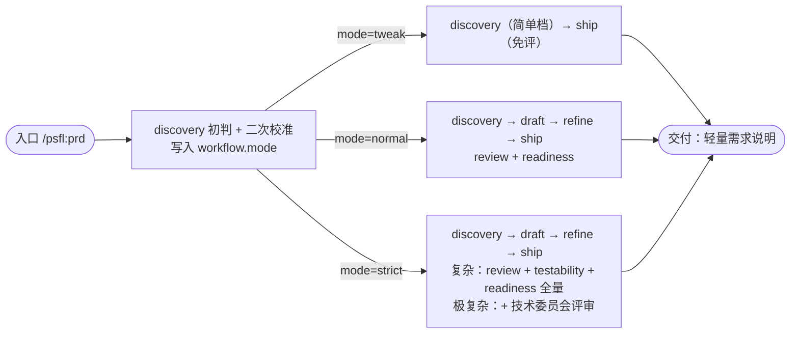

# PRD 分级工作流程设计方案

> 状态：草案（待评审）。本文档回答一个问题：**简单需求与复杂需求是否该共用同一条 PRD 链路、同样多次评审与确认？若不该，如何按复杂度分级？**
>
> ⚠️ **已被修订（2026-10-30）**：判定主轴（逻辑复杂度→变更风险）、简单档（新造轻量需求说明→draft 单页/变更说明）、标准档 testability（免除→降级）、极复杂单列档（→strict 内 critical 标记）等已被 `2026-10-30-prd-complexity-axis-revision.md` 修正，以该文档为准。
>
> **权威源**（本文档与它们冲突时以它们为准）：
>
> | 内容 | 唯一来源 |
> |------|----------|
> | 现状 PRD 主链路 / 阶段 / 服务型技能 | `docs/design/prd-workflow-flows.md` |
> | 阶段序列、产物登记 | `src/core/config/task-kind-layout.ts` 的 `kind: 'requirement'` 条目 |
> | 复杂度评分三档 | `assets/zh/skills/prd/discovery/policies/complexity-assessment-policy.md` |
> | 变更分级信号表（`tier → workflow.mode` 单源映射） | `assets/zh/policies/risk-signals.md` |
> | 人工确认协议 | `assets/zh/policies/decision-point.md` |
> | 阶段衔接（manual / auto） | `assets/zh/policies/auto-transition.md` |
>
> 本文档是**方案提案**，不是现状描述：现状事实标注 ✅，外部实践标注 🔎（附来源），设计决策标注 ✍️，估算标注 ⚠️。

---

## 1. 现状梳理

### 1.1 主链路与环节

✅ PRD 族是一条**严格串行、无跳档**的主链路：`discovery → draft → refine → ship`，外加三个被上游调度的服务型技能（`review` / `testability` / `readiness`）。

| 游标 phase | 技能 | 中文名 | 主产物 |
|-----------|------|--------|--------|
| `discovery` | `discovery` | 澄清 | 《需求基线》(9 章) + 《澄清纪要》(5 章) + 命名三件套 |
| `draft` | `draft` | 草稿 | 4 章轻量初稿（5 个分章文件）+ 交叉校验报告 |
| `refine` | `refine` | 完善 | 11 章 + 4 附录终稿 + 评审报告 + 评审支撑包 |
| `ship` | `ship` | 交付 | 研发就绪度评估 + 终稿迁入 `docs/prd/` + 任务收尾 |

**关键事实**：`TASK_KIND_LAYOUTS.requirement` **没有** `modePhases` 字段，四个阶段对**所有**需求一视同仁。对比之下，`coding` 族有 `modePhases`（`tweak` 跳 plan/design、`normal` 跳 design、`strict` 全走）——**需求侧缺少这个分级机制**。

### 1.2 参与角色

✅ 现状是「AI 主代理 + subagent 评审员 + 单人确认」三元，**没有分级的角色概念**：

| 角色 | 职责 | 出场位置 |
|------|------|---------|
| AI 主代理 | 执行各阶段、落盘产物 | 全程 |
| subagent 评审员 | 业务评审 / 可测性检查 / 就绪度评估（只评不改） | refine Step 4、ship Step 1 |
| 人工（用户） | 在阻塞点确认 / 否决 | 全程 12 个阻塞点 |

评审由 subagent **模拟**（review 7 维度、testability 4 维度、readiness 5 维度），人工只做「确认/否决」，不做「专业评审」。**没有**产品/研发/测试/合规的显式分工，也**没有**审批层级——只有一个用户签字。

### 1.3 评审与确认步骤

✅ **评审类检查固定 3 次，全部强制执行**（不分复杂度）：

| 评审 | 维度 | 分级 | 触发位置 |
|------|------|------|---------|
| `review` 业务评审 | 7 维度（一致性/完整性/自洽/规则/可实现/合规/双向追溯） | P0~P3 | refine Step 4.1 |
| `testability` 可测性 | 4 维度（验收/规则/场景/指标） | T0~T3 | refine Step 4.2 |
| `readiness` 就绪度 | 5 维度加权（D4 技术设计支撑度占 33%） | PASS/CONDITIONAL/FAIL | ship Step 1 |

✅ **人工确认阻塞点 12 个**（`prd-workflow-flows.md` §6），其中 `draft` Step 3 与 `refine` Step 2 是**逐章确认**（draft 5 章、refine 11 章 + 4 附录），故实际人工往返数取决于是否逐章：

| 阶段 | 单点阻塞 | 逐章确认 | 合计（往返次数） |
|------|---------|---------|-----------------|
| discovery | 4（任务选择 / 选中任务 / 命名 / 整体确认） | — | 4 |
| draft | 1（缺失项处理） | 5 | 6 |
| refine | 2（补全范围 / 修复确认） | 15（或全量 1 次） | 3 ~ 17 |
| ship | 3（FAIL 处理 / 确认交付 / 文件冲突） | — | 3 |
| **总计** | | | **16 ~ 30** |

### 1.4 耗时估算

⚠️ 现状文档**无显式时间数据**，以下为基于步骤数与交互模型的结构性估算，非实测：

- AI 生成侧：discovery 澄清数轮 + draft 5 章 + refine 15 章 + 3 次评审，单阶段分钟级~小时级，**总生成时间量级为小时级**。
- **人工等待侧（占主导）**：耗时与阻塞点数量线性相关。每个确认点需「暂停 → 用户阅读 → 反馈 → 恢复」一轮往返，异步场景下每轮 10~30 分钟。16~30 个阻塞点 ⇒ 简单需求的人工在途时间也可能被拖到 **2~5 个工作日**（跨会话等待）。
- **结论**：简单需求（如增删改查、逻辑简单的功能）在现状下与复杂需求承担几乎相同的流程与等待成本——**这是本方案要解决的核心问题**。

### 1.5 现状问题（一句话）

✅ 复杂度三档（简单/标准/复杂）**只联动执行粒度**（模糊点扫描维度、澄清轮次、图表深度、风险清单条数），**不联动流程强度**——阶段环节、评审次数、确认粒度、审批权限四项对所有需求一刀切。

---

## 2. 外部实践调研

针对「简单复杂共用流程、均需多轮评审确认」这一问题，业内成熟实践高度一致：**先分级，再决定流程强度**。

### 2.1 分级判定 + 弹性输出（B2B 弹性 PRD）

🔎 来源：BestHub《A Flexible PRD Framework for B2B Product Managers》/ 微信公众号「To B 产品经理的弹性 PRD 工作法」。三级响应策略：

| 级别 | 典型需求 | 策略 |
|------|---------|------|
| Level 1 大型项目/复杂功能 | 全新审批流、多租户平台 | 完整结构化 PRD（干系人地图 + RBAC + BPMN + 接口 + NFR + 多轮分层评审） |
| Level 2 中型功能/优化 | 批量操作、统计逻辑、新报表 | 轻量需求说明（目标 + 方案 + 规则 + 验收，省略冗长背景） |
| Level 3 微小调整/缺陷 | 改文案、调样式、修明确 Bug | 口头确认 + 任务卡片（截图 + 一句话） |

核心判断维度：**干系人数量、方案选项多寡、跨系统风险**。底线不妥协：「目标清晰、方案无歧义、验收可验证」三要素任何级别都保留。

### 2.2 风险分级决定分析深度与审批范围

🔎 来源：Worktile《PRD 流程与规范 / 产品需求 PRD 全流程》。四维度分级 + 角色分工：

- **判定四维度**：影响范围（单页/单团队 vs 多业务线/共享平台）、失败后果（资金/权限/隐私/合规/连续性）、不确定性（未验证的用户/技术/外部规则）、可回滚性（能否快速关闭/回滚/降级）。
- **审批分层**：区分「谁提专业意见」「谁做业务取舍」「谁担发布责任」，**不要让所有人对所有事项都签字**。
- **风险档 → 分析深度**：

| 风险档 | 典型特征 | 分析深度 |
|--------|---------|---------|
| 低 | 单一界面、局部文案、可快速回滚 | 场景 + 范围 + 基本验收 |
| 中 | 多角色、跨模块规则 | 主流程 + 异常 + 依赖 + 数据口径 |
| 高 | 资金/权限/合规/迁移/难回滚 | 完整规则 + 风险评估 + 灰度 + 回退方案 |

### 2.3 DoR（就绪度）本身也要分级

🔎 来源：agility.ac / Netspective《Definition of Ready》。DoR 是一份 **checklist 而非 stage-gate**，应「按上下文灵活应用，而非对每个需求机械套用全部条目」；用 bronze/silver/gold 三级标记 backlog 就绪度，让评审资源流向真正需要细化的工作项。

### 2.4 对本项目的启示（三条）

✍️ 归纳外部实践与本仓既有机制的映射：

1. **分级先于流程**：把复杂度判定提前到 discovery 早期（现状已做初判，但只用于调粒度），并让它决定**走哪条链路**。
2. **流程强度与风险成正比**：专家评审时间花在风险最大处；低风险需求走轻量链路 + 异步确认，而非取消质量底线。
3. **复用本仓已有机制，不新造**：`coding` 族已有 `tier → workflow.mode → modePhases` 的成熟分级链路（`risk-signals.md` §1），需求侧应复用同一套，而非另立一套。

---

## 3. 复杂度判定标准（重定义）

### 3.1 判定主轴：逻辑复杂度，而非「新增多少实体/场景」

✍️ 现状 `complexity-assessment-policy.md` 的 33 分表用「新增数据实体 +2/3 分」「新增完整业务流程 +4 分」衡量复杂度，导致一个错判：**增删改查（CRUD）类功能——逻辑简单、但新增了 1~2 个实体和一套业务流程——按现表会落在「标准档」（约 7~11 分）**。这正是「简单需求被流程拖死」的根因：不是流程没分级，是**分级标准把逻辑简单的功能判成了标准档**。

✍️ 判定主轴改为**逻辑复杂度**（业务规则、状态流转、计算、并发/事务），规模与实体数量降为辅助信号，风险仍一票否决：

| 主轴 | 简单 | 标准 | 复杂 |
|------|------|------|------|
| 功能形态 | 增删改查、简单表单、展示、状态开关 | 多角色多场景业务模块 | 跨系统、核心链路改造 |
| 业务规则 | 极简（≤3 条：必填/唯一/格式/范围） | 明确规则（4~15 条） | 复杂规则（>15 或规则联动） |
| 状态流转 | ≤2 个状态 | 3~5 个状态 | 复杂状态机 / 并发 / 事务 / 幂等 |
| 计算/统计 | 无或极简 | 有（聚合/统计/计算） | 复杂计算 / 资金 / 时序 |
| 数据实体 | ≤2 个、结构简单 | 2~5 个 | >5 个或复杂关联 |
| 跨系统 | 单系统 | 单系统内多模块 | 2+ 独立系统 |
| 高危信号 | 无 | 无 | 资金/敏感个人信息/监管/核心链路（**一票复杂起步**，见 policy §5） |

### 3.2 四档定义（评估）

> 评估分四档，流程档位映射三档（见 §4 与 policy §7）。评分细则见 `complexity-assessment-policy.md`，本节只列定义与典型场景。

| 等级 | 定义 | 典型场景 |
|------|------|---------|
| 简单 | 逻辑简单，含增删改查 | 标准 CRUD（列表/新增/编辑/详情/删除）；简单表单与展示；状态开关；极简校验 |
| 标准 | 有明确业务规则 | 多角色多场景功能模块；中等状态机；业务计算/聚合；局部逻辑调整 |
| 复杂 | 逻辑复杂或高危 | 跨系统；复杂状态机/并发/事务；资金/敏感个人信息/监管合规；核心链路改造 |
| 极复杂 | 高危重度 / 多系统核心重构 | 跨多系统核心重构；大规模数据模型改造；强监管高危场景；核心生产链路重大调整 |

### 3.3 与评分表的关系（已落地）

✅ `complexity-assessment-policy.md` **已重标为 50 分四档**（业务 20 + 技术 20 + 合规 10），阈值：简单 0-6 / 标准 7-18 / 复杂 19-30 / 极复杂 31+；以「逻辑复杂度」为主轴、规模为辅助，并通过 §4.2 CRUD 豁免规则保证增删改查稳定落「简单」。本节四档定义与 policy 直接对应，无冲突。

### 3.4 判定时机与双向校准

✍️ 沿用现状两段式判定，并把「档位」作为权威值写入 state：

- **初判**：discovery Step 2.2（快分流，选链路）
- **二次校准**：discovery Step 3.4（**双向校准**——上调直接生效、下调须用户按 `decision-point.md` 显式确认，见 policy §6.2）
- **权威冻结**：discovery 出口写 `workflow.mode`（见 §6.2），此后不变更——与 `coding/specify` Step 5.5「出口权威判档，过了即冻结」同构。

---

## 4. 分级工作流设计

### 4.1 四档总览

✍️ 评估四档命名沿用「简单/标准/复杂/极复杂」，流程档位映射 coding 的三档 `workflow.mode`（`tweak`/`normal`/`strict`）——复杂与极复杂都走 `strict`，极复杂为 `strict` 内最高强度（见 policy §7）。

| 维度 | 简单（轻量链路） | 标准（标准链路） | 复杂（严格链路） | 极复杂（严格链路·最高强度） |
|------|-----------------|-----------------|-----------------|---------------------------|
| **阶段序列** | `discovery → ship` | `discovery → draft → refine → ship` | `discovery → draft → refine → ship` | 4 阶段全走 + 里程碑拆分交付 |
| **评审次数** | 0（readiness 免评） | 2（review + readiness） | 3（review + testability + readiness） | 3 次 + 技术委员会评审 |
| **人工确认** | 2 个阻塞点 | ~5 个阻塞点（整稿确认） | 现状全量（逐章确认） | 逐章确认 + 里程碑确认 |
| **参与角色** | AI + 需求提出人 | AI + 产品负责人 +（技术复核） | AI + 产品 + 技术 + 合规 | AI + 产品 + 技术 + 合规 + 架构师/技术委员会 |
| **审批权限** | 需求提出人单点确认 | 产品负责人确认 + 技术复核 | 多角色会签，高危须合规签字 | 技术委员会会签，合规硬性签字 |
| **交付物** | 轻量需求说明（功能 + 字段 + 规则 + 验收） | 标准 PRD（精简章节） | 完整 PRD（11 章 + 4 附录） | 完整 PRD + 分阶段交付计划 + 专项测试/安全审计方案 |

### 4.2 简单档（轻量链路，`workflow.mode = tweak`）

✍️ **定义**：增删改查类功能、逻辑简单的功能（标准 CRUD、简单表单/展示、状态开关、极简校验）。

✍️ **阶段**：`discovery → ship`，跳过 `draft`、`refine`。

- **discovery（简单档）**：核心 3 维扫描、单轮批量澄清，产出**轻量需求说明**（非 9 章完整基线）——含功能清单（CRUD 各动作）、字段表、校验规则、权限、验收标准。
- **交付物**：轻量需求说明（1~2 页），由 discovery 产出、ship 交付。
- **评审**：0 次全量评审。`review` / `testability` 全免；`readiness` 走**免评路径**——但现状免评条件 E1 只覆盖「纯文案变更」，**需扩展**一条「逻辑简单的 CRUD」免评信号（落地项，见 §6.3）。
- **确认**：2 个阻塞点——① 命名三件套（discovery Step 2.6.1）；② 整体确认（discovery 出口，即交付前）。
- **审批**：需求提出人（用户）单点确认即交付。
- **适用条件**：增删改查 / 逻辑简单；单系统；无高危信号；规则 ≤3 条、状态 ≤2、实体 ≤2 且结构简单。
- **边界（升档）**：澄清中一旦发现复杂业务规则、复杂状态流转、跨系统、资金/敏感/合规信号，**立即升档重走**（致命信号一票复杂起步、严重信号逐级升，见 policy §5）。注意：**新增数据实体本身不是升档理由**（CRUD 天然新增实体）。

### 4.3 标准档（标准链路，`workflow.mode = normal`）

✍️ **阶段**：`discovery → draft → refine → ship`（现状 4 阶段不变）。

- **评审**：**2 次** —— `review`（7 维度，业务评审是质量底线）+ `readiness`（准出判定是研发放行底线）；**免 `testability`**（其「验收标准/规则可判定」已由 review 维度 4「规则明确性」+ 维度 2「范围完整性」覆盖；复杂需求才需独立的 GWT 补全与 A/B/C/D 评级）。
- **确认**：**~5 个阻塞点**，逐章确认降为**整稿一次确认**——① 命名三件套；② 基线整体确认（discovery 出口）；③ 初稿整稿确认（draft 出口，替代逐章）；④ 终稿补全范围 + 整稿确认（refine）；⑤ 确认交付（ship）。
- **角色**：AI 执行 + AI 评审（review/readiness）；产品负责人确认；涉及接口/数据实体变更时，增加**技术负责人复核**（可由 readiness 的 D4 技术设计支撑度 + 人工复核承载）。
- **审批**：产品负责人确认即交付；技术复核为「专业意见」非「签字」。
- **适用条件**：总分 7-18 且无高危信号；多角色、单系统内新增功能、常规业务流程、局部逻辑调整。
- **边界**：命中高危信号 → 升复杂档；若澄清后确属单点改动 → 可降简单档（须用户按 `decision-point.md` 显式确认，只降一次）。

### 4.4 复杂档（严格链路，`workflow.mode = strict`）

✍️ **阶段**：`discovery → draft → refine → ship`，全量。

- **评审**：**3 次全量** —— `review` ∥ `testability`（refine Step 4 并行）+ `readiness`（ship Step 1），全部强制执行，P0/T0 清零 + 双门槛（总分 ≥80 且 D1~D4 ≥60）。
- **确认**：现状全量（12 阻塞点 + 逐章确认）。
- **角色**：AI 执行 + AI 全量评审；**产品负责人 + 技术负责人 + 合规/安全**多角色参与。
- **审批**：多角色会签；涉及资金/敏感个人信息/监管合规时，合规维度结论为**硬性签字项**（对应 readiness D5 不确定性与风险管理 + review 维度 6 合规性）。
- **适用条件**：总分 19-30；或命中致命高危信号（一票复杂起步，见 policy §5.1）。
- **边界**：下调须用户按 `decision-point.md` 显式确认（policy §6.2），不得静默降档；确认后重新定档并重走对应链路。

### 4.5 极复杂档（严格链路最高强度，`workflow.mode = strict`）

✍️ **阶段**：`discovery → draft → refine → ship` 全走，并**按里程碑拆分交付**（分阶段产出 + 分阶段确认，而非一次性交付整稿）。

- **评审**：**3 次全量**（同复杂档）+ **技术委员会评审**（架构师/技术负责人对方案、数据模型、核心链路改造做专项评审）。
- **确认**：逐章确认（同复杂档）+ **里程碑确认**（每个里程碑交付前设确认点，替代复杂档的「一次性逐章」）。
- **角色**：复杂档全部角色 + **架构师 / 技术委员会**。
- **审批**：技术委员会会签；涉及资金/敏感个人信息/监管合规时，合规为硬性签字项。
- **适用条件**：总分 31+；或复杂档命中致命高危信号逐级升档（见 policy §5.1）。
- **边界**：下调须用户按 `decision-point.md` 显式确认（policy §6.2），不得静默降档。

> 与复杂档的关系：同为 `strict` 链路，差异在「强度」——极复杂多出技术委员会评审、里程碑拆分、架构师参与、专项测试/安全审计（见 policy §3 管控要求列）。

### 4.6 评审强度分档（一句话原则）

✍️ **评审次数 = 风险需要的证据量**，不是仪式：

| 档 | 保留 | 免除 | 理由 |
|----|------|------|------|
| 简单 | —（readiness 免评） | review / testability / readiness | CRUD/逻辑简单，规则与状态极简，无技术设计支撑需求，验收可由功能清单 + 字段校验直接判定 |
| 标准 | review + readiness | testability | 业务评审与准出是质量/放行底线；可测性并入 review，独立 GWT 补全收益低 |
| 复杂 | review + testability + readiness | — | 验收标准/场景覆盖/数据指标可验证性、技术设计支撑度是硬约束 |
| 极复杂 | review + testability + readiness + 技术委员会评审 | — | 复杂档全部 + 架构师/技术委员会对方案、数据模型、核心链路改造专项评审 |

### 4.7 人工确认分档

✍️ 逐章确认在**复杂 / 极复杂档**保留（极复杂额外增加里程碑确认）；简单/标准档降为整稿或整体确认。完整映射见附录 B。

### 4.8 角色与审批权限分档

✍️ 当前平台是**单人对话**，无多参与者审批流。设计分两层落地：

- **本阶段可落地**：角色由 **subagent 模拟专业评审 + 用户在确认点代表审批**。简单档 = 用户单点；标准档 = 用户 + readiness 技术复核维度；复杂档 = 用户 + review 合规维度 + readiness 技术维度；极复杂档 = 复杂档 + 架构师/技术委员会（subagent 模拟）。
- **理想态（需平台能力）**：多参与者审批流（产品/技术/合规分别签字），列为后续演进，见 §6.1 阶段四。

| 档 | 审批人 | 审批粒度 |
|----|--------|---------|
| 简单 | 需求提出人 | 单点确认（命名 + 整体） |
| 标准 | 产品负责人 +（技术复核） | 整稿确认 + 准出确认 |
| 复杂 | 产品 + 技术 + 合规会签 | 逐章确认 + 全量评审 + 准出会签 |
| 极复杂 | 技术委员会会签 | 逐章 + 里程碑确认 + 全量评审 + 准出会签 |

### 4.9 适用条件与边界（汇总）

| 档 | 适用条件（总分） | 边界（升/降，详见 policy §5） |
|----|----------------|-------------------------------|
| 简单 | 0-6 | 致命高危 → 一票复杂起步；严重高危 → 升标准；复杂规则/状态 → 升档（新增实体本身不升档） |
| 标准 | 7-18 | 致命高危 → 复杂起步；严重高危 → 升复杂；确属单点 → 可降简单（显式确认，只降一次） |
| 复杂 | 19-30 | 致命高危 → 升极复杂 |
| 极复杂 | 31+ | 下调须显式确认（policy §6.2） |

---

## 5. 与现状对比（改进点）

| 维度 | 现状 | 改进后 | 收益 |
|------|------|--------|------|
| 流程环节 | 4 阶段全走（无 modePhases） | 简单 2 阶段 / 标准·复杂 4 阶段 | 简单需求免 draft/refine |
| 评审次数 | 3 次全走 | 0 / 2 / 3 | 评审资源流向风险最大处 |
| 人工确认 | 16~30 次往返 | 2 / ~5 / 全量 | 简单需求从「跨天等待」降到「分钟级」 |
| 参与角色 | 无分级（单人确认 + AI 自评） | 分级（+ 技术复核 / 合规会签） | 角色职责清晰，避免「所有人对所有事签字」 |
| 审批权限 | 单一用户签字 | 分级审批 | 高风险需求有合规硬性签字项 |
| 复杂度联动 | 只调执行粒度 | 调流程强度（阶段 + 评审 + 确认 + 审批） | 复杂度从「装饰」变「链路开关」 |

**核心改进**：复杂度判定从「只决定写多细」升级为「决定走哪条链路、评几次、谁签字」。低风险需求不被流程拖死，高风险需求不被轻判漏网——与 `coding` 族 `tweak/normal/strict` 的语义完全对齐。

---

## 6. 落地建议

### 6.1 分阶段落地（低风险优先）

| 阶段 | 内容 | 改动面 | 风险 |
|------|------|--------|------|
| **一 · 机制对齐** | `TASK_KIND_LAYOUTS.requirement` 增补 `modePhases`：`tweak: [discovery, ship]`、`normal/strict: 全序列`；复用 `phasesForMode` / `nextPhaseForMode` | `src/core/config/task-kind-layout.ts` 一处 | 低（纯复制 coding 既有机制） |
| **二 · 判定重标** | ✅ 已完成：`complexity-assessment-policy.md` 已重标为 50 分四档（§3.3） | policy 一处 | 已完成 |
| **三 · 档位落盘** | discovery 出口按复杂度写 `workflow.mode`（简单→tweak / 标准→normal / 复杂·极复杂→strict），映射单源收口到 `complexity-assessment-policy.md` §7 | discovery SKILL + 映射表 | 低 |
| **四 · 产物改造** | 简单档 discovery 产出**轻量需求说明**（功能清单 + 字段表 + 校验规则 + 验收标准），而非 9 章基线 | discovery SKILL + 轻量说明模板 | 中 |
| **五 · 评审裁剪** | refine 读 `workflow.mode`：normal 跳 testability、tweak 不进 refine；`readiness` 免评信号扩展「逻辑简单的 CRUD」 | refine/ship SKILL | 中 |
| **六 · 确认粒度裁剪** | draft/refine 按 mode 决定「逐章确认」vs「整稿一次确认」 | draft/refine SKILL | 中 |
| **七 · 多角色审批（理想态）** | 引入多参与者审批流 | 平台能力 + 技能 | 高（暂缓） |

### 6.2 架构对齐点（关键设计决策）

✍️ 需求侧复用 `workflow.mode`，而非另立字段，理由：`modePhases` 是阶段序列的唯一真相（`phasesForMode` 等三个派生函数都读它），**技能与命令不复制这张表**。若需求侧另立「复杂度→阶段」表，会再产生一张漂移的转移表（`task-kind-layout.ts` 注释已明确反对）。因此：

- **复杂度（简单/标准/复杂/极复杂）是判定输入**，`workflow.mode`（tweak/normal/strict）是**权威档位**，两者通过映射关联——与 `risk-signals.md` §1「`trivial→tweak`、`standard→normal`、`critical→strict`」同构，只是需求侧的输入名不同（复杂度四档 vs 变更分级三档；复杂·极复杂都映射 `strict`）。
- **映射单源**：✅ 已落地在 `complexity-assessment-policy.md` §7，不散落。

### 6.3 风险与注意

1. **Dashboard 产物检测**：`TASK_KIND_LAYOUTS.requirement.artifacts` 按阶段登记产物。简单档跳过 draft/refine 后，`prd-draft.md` / `prd-final-v1.0.md` 不再产生，`artifacts` 登记与进度条须同步——否则阶段进度判定失真（历史已有同类坑，见 `prd-workflow-flows.md` §8）。
2. **简单档交付物是轻量需求说明而非 11 章 PRD**：`ship` 需支持交付轻量需求说明（功能清单 + 字段表 + 校验规则 + 验收标准），文件名与 `docs/prd/` 归档规则需补一条轻量档约定。
3. **简单档 readiness 免评信号需扩展**：现状免评条件 E1 只覆盖「纯文案变更」，CRUD 不在其中——须新增一条「逻辑简单的 CRUD」免评信号，否则简单档仍会被 readiness 拦下全评。
4. **升档必须重走**：简单档一旦触发升档信号必须重走，不得因已投入而豁免——防止「先走轻量省事、再靠复杂档兜底」的投机。
5. **判定时机前置**：复杂度须在 discovery 早期锁定（初判 + 二次校准），否则 draft/refine 已开始才升档会返工。与 `coding/specify`「出口冻结」同构。
6. **testability 在标准档免掉后**，其「可测性 A/B/C/D 评级」不再产出——标准档的验收完整性由 review 维度 2/4 兜底，需在 review 维度描述里显式补一句「含验收标准完整性」，避免口径真空。

---

## 附录 A：复杂度判定完整信号表

| 维度 | 信号 | 简单 | 标准 | 复杂 |
|------|------|------|------|------|
| 功能形态 | CRUD/表单/展示 vs 业务模块 vs 跨系统 | 增删改查、简单表单、展示、状态开关 | 多角色多场景模块 | 跨系统、核心链路改造 |
| 业务规则 | 规则数量 | ≤3 条 | 4~15 条 | >15 或规则联动 |
| 状态流转 | 状态数与流转复杂度 | ≤2 个状态 | 3~5 个状态 | 复杂状态机 / 并发 / 事务 |
| 计算/统计 | 计算复杂度 | 无或极简 | 有（聚合/统计/计算） | 复杂计算 / 资金 / 时序 |
| 数据实体 | 实体数与关联 | ≤2 个、结构简单 | 2~5 个 | >5 个或复杂关联 |
| 跨系统 | 是否跨独立系统 | 单系统 | 单系统内多模块 | 2+ 独立系统 |
| 风险等级 | 高危信号 | 无 | 无 | 资金/敏感个人信息/监管/核心链路（**一票复杂起步**，见 policy §5） |

> 逻辑复杂度为主轴（业务规则/状态/计算/并发），规模与实体为辅助，高危信号一票复杂起步。`complexity-assessment-policy.md` 已重标为 50 分四档（极复杂由总分 31+ 或致命高危判定，见 policy §3/§5）；本表与 policy §4.1 主轴表一致。

## 附录 B：现状 12 确认点 → 四档裁剪对照

| # | 确认点 | 简单 | 标准 | 复杂 | 极复杂 |
|---|--------|------|------|------|--------|
| 1 | discovery 活跃任务选择 | ✅ | ✅ | ✅ | ✅ |
| 2 | discovery 选中 1 个任务 | ✅ | ✅ | ✅ | ✅ |
| 3 | discovery 命名三件套 | ✅ | ✅ | ✅ | ✅ |
| 4 | discovery 整体确认（基线） | ✅ | ✅ | ✅ | ✅ |
| 5 | draft 逐章确认（5 章） | —（无 draft） | 🔶 整稿一次 | ✅ 逐章 | ✅ 逐章 |
| 6 | draft 缺失项处理 | — | 🔶 | ✅ | ✅ |
| 7 | refine 补全范围 | —（无 refine） | ✅ | ✅ | ✅ |
| 8 | refine 逐章确认（11+4） | — | 🔶 整稿一次 | ✅ 逐章 | ✅ 逐章 |
| 9 | refine 修复确认 | — | ✅ | ✅ | ✅ |
| 10 | ship FAIL 处理 | ✅（免评后罕见） | ✅ | ✅ | ✅ |
| 11 | ship 确认交付 | ✅ | ✅ | ✅ | ✅ |
| 12 | ship 文件冲突 | ✅ | ✅ | ✅ | ✅ |

> ✅ 保留；🔶 降级为整稿确认；— 阶段被跳过。简单档实际阻塞点 = {3, 4}（命名 + 整体确认）。极复杂档 = 复杂档全部确认点 + 每个里程碑交付前的「里程碑确认」（见 §4.5）。
