# coding 工作流技能流程图

> 本文档描述 `assets/zh/skills/coding/` 下 12 个技能的组织方式与流转关系（**三层架构**：入口层 / 调度层 / 执行层）。
>
> **权威源**（本文档与它们冲突时以它们为准）：
>
> | 内容 | 唯一来源 |
> |------|----------|
> | 阶段序列、**档位 → 阶段序列**（`modePhases`）、各阶段产物 | `src/core/config/task-kind-layout.ts` 的 `kind: 'coding'` 条目 |
> | 各技能内部步骤 | 各技能目录下的 `SKILL.md` |
> | 阶段衔接方式（manual / auto） | `assets/zh/policies/auto-transition.md` |
> | **恢复分发（游标 `phase` → 技能）** | `src/core/config/task-kind-layout.ts` 的 `skillForModePhase` |
> | **档位与分级判据** | `assets/zh/policies/risk-signals.md`（§1 档位定义 + **分级→档位的单源映射**；§2 四个判定点） |
> | `task-entry` 原语细则 | `assets/zh/skills/coding/intake/policies/task-entry.md`（**`intake` 私有**，随技能安装） |
> | 人工确认协议 | `assets/zh/policies/decision-point.md` |
>
> 文档不含菜单编号（C/M/R/P/T 前缀码属命令层 UI 概念，技能层不引用）。

---

## 1. 三层架构与三条工作流

coding 技能族是**三层**：入口层只声明档位、调度层统一建任务与转交、执行层只做本阶段。

| 层 | 技能 | 职责 |
|---|---|---|
| **入口层** | `tweak` / `normal` / `strict`（各约 35 行） | **只声明档位** → 加载 `intake`；不建任务、不产出任何产物 |
| **调度层** | `intake` | 恢复分发 → 入口判档 → 任务初始化 → 转交 |
| **执行层** | `specify` / `plan` / `design` / `tasks` / `build` / `verify` / `ship` | 只做本阶段；读 `workflow.mode` 决定工序强度 |

🔴 **执行层只有一个入口 = `intake`**：节点技能**不得被直接调用，也不得互相直接调用**
—— 含**阶段出口的自动衔接**：那一跳同样回 `intake`（见 `assets/zh/policies/auto-transition.md`）。

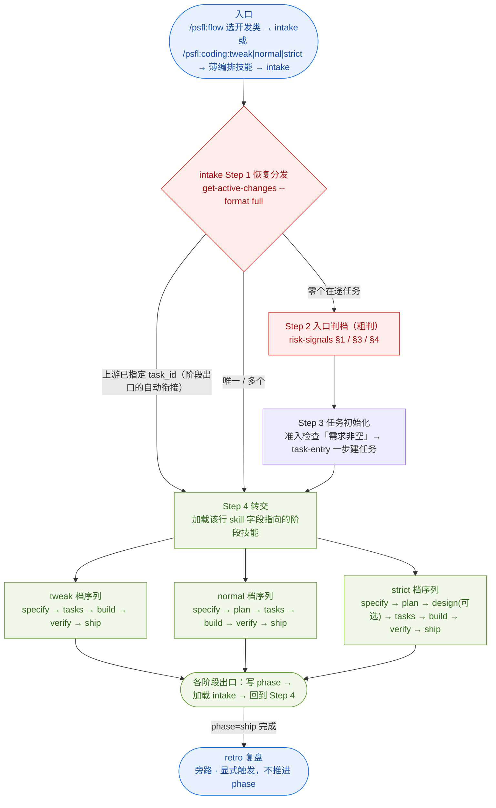

三条工作流的差异：

| 维度 | `tweak`（简单） | `normal`（常规） | `strict`（复杂） |
|------|-------|--------|----------|
| 阶段序列 | `specify → tasks → build → verify → ship` | `specify → plan → tasks → build → verify → ship` | `specify → plan → design(可选) → tasks → build → verify → ship` |
| 承载技能数 | 5 | 6 | 7（`design` 可选） |
| 规格产物 | `intention.md`（9 节写满、内容极简）+ `tasks.md` | 四件套 + `intention.md` | 四件套 + `intention.md` + `detailed-design.md`（深化时） |
| 独立主审 | 无（`tasks` Step 7 **本档豁免**） | `tasks` 主审（design 若深化另有 design 主审） | 同上 + 可选 Outside Voice |
| 人工确认 | **3 次** | ~5 次 | ≥ 10 次 |
| 四件套 | ⛔ 不产出 → 由 `ship` 的 `artifact-backfill` 补齐 | 产出 | 产出 |

> **档位 → 阶段序列的唯一真相 = 代码表**：`TaskKindLayout.modePhases`
> （派生 `phasesForMode` / `nextPhaseForMode` / `isPhaseInMode`）。
> **未登记 / 空的 `mode` 落回全序列**（存量不崩）；旁路阶段 `retro` **不在任何档的序列里**。

### 1.1 恢复分发与转交判据

**游标 `phase` 决定"该谁做"；`workflow.mode` 只决定"那一段的工序强度"。**

- 派生函数：`task-kind-layout.ts` 的 **`skillForModePhase(kind, phase)`**（**2 参**）—— 入口阶段返回**同名技能**
  （分发要回答"该进哪个技能"）；旁路 `retro` → `null`。
  与 **`skillForPhase(kind, phase)`** 分工勿混：后者服务**出口**的 `state next`，**入口阶段返回 `null`**。两者**同源同一张阶段表**。
- 命令入口：`polaris-flow workflow-entry get-active-changes --kind coding --format full`
  → 每行含 `task_id` / `worktree_path` / `state_path` / `phase(_label)` / `mode(_label)` / **`skill`（= 应执行技能）** /
  `skill_label` / `state_readable`。⚠️ `state_readable=false` 或 `phase` 空 → **必须阻断**，不得当成"零个"新建。
- ⇒ **只有 `intake` 读 `get-active-changes`**；执行层技能**不查任务** —— 它们的 Step 1 只**接收 `intake` 的交接**（必带 `task_id` / `worktree_path`）。

| 项 | 规则 |
|---|---|
| **建任务** | `intake` Step 3：**一次 `task-entry` 调用**完成「建目录 + 写 `workflow.mode` + 注册游标（幂等）」；前置只有「需求内容非空」（H14） |
| **转交** | `intake` Step 4：新建 → `phasesForMode(kind, 档)[0]`（三档都是 `specify`）；已有任务 → 该行 **`skill` 字段**。**同会话加载**，不要求用户再敲命令 |
| **状态变了** | `task-entry` 的 `resume` / `handover` / `select` / `block` 出口**在 Step 3 不该出现** ⇒ 回 Step 1 重判 |
| **档位变更** | 🔴 **唯一位置 = `specify` 的出口**（那时产物只有 `intention.md` ⇒ 改档零返工）：判 level → 按 `risk-signals.md` §1 单源映射折算 → 变档需用户确认 → `set workflow.mode` → `complete-phase`（**不传 `--next-phase`**，按新 `mode` 派生）。**过了 `specify` 即冻结**，其余阶段纯按 `skill` 转交 |
| **衔接落点** | 阶段出口 → **加载 `intake`**（**不是**"下一个阶段技能"）；`state next` 给出的技能名只用于**提示语与恢复清单** |
| **`phase=ship`** | 一律归 `ship`（三档共用）；`tweak` 档还要跑 `artifact-backfill` 补齐四件套 |
| **入口判档** | 只是**粗判**，用于"选哪个入口技能"；信息不足 → 落**默认档 `normal`**。**权威判定在 `specify` 出口** |

---

## 2. 执行层：阶段 / 技能 / 产物

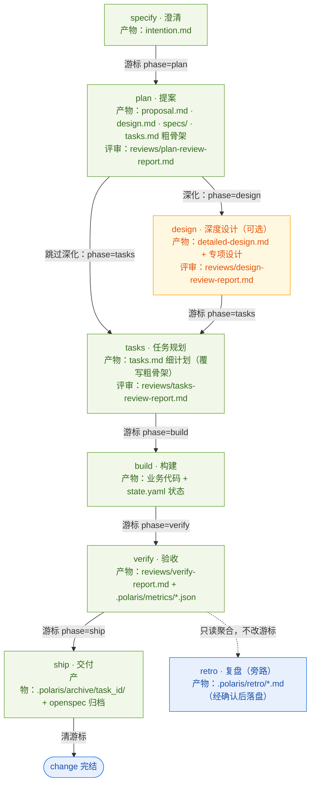

### 阶段-技能-产物对照

| 游标 phase | 技能 | 中文名 | 主产物 | 评审报告 |
|-----------|------|--------|--------|----------|
| `specify` | `specify` | 澄清 | `openspec/changes/<id>/intention.md` | — |
| `plan` | `plan` | 提案 | `proposal.md`、`design.md`、`specs/`、`tasks.md`（粗骨架） | `reviews/plan-review-report.md`（+ 可选 `reviews/openspec-review-report.md`） |
| `design`（可选） | `design` | 深度设计 | `detailed-design.md` 及专项设计（`data-model-design.md` / `restful-api-design.md` 等） | `reviews/design-review-report.md` |
| `tasks` | `tasks` | 任务规划 | `tasks.md`（细计划） | `reviews/tasks-review-report.md` |
| `build` | `build` | 构建 | 业务代码 + `.polaris/tasks/<id>/state.yaml` | `reviews/code-review-report.md`（按 `review_mode`） |
| `verify` | `verify` | 验收 | `reviews/verify-report.md` + `.polaris/metrics/<ts>-metrics.json` | 同上 |
| `ship` | `ship` | 交付 | `.polaris/archive/<id>/`、`openspec/changes/archive/` | — |
| `retro`（旁路） | `retro` | 复盘 | `.polaris/retro/<UTC>-report.md` | — |

**入口阶段**：`specify` 由 `intake` 显式转交进入，不走 `state next`（阶段表中 `skill: null`）。
**旁路阶段**：`retro` 只出现在 `state.yaml`，不属推进游标主序列，也不计入进度分母。⚠️ 它是**调度层豁免**的技能 —— **由用户直接调用**，不经 `intake`、也不被任何技能自动转交（见 §4.8）。

> 🔴 **档位与阶段的关系**：上表是 **`strict` 的全序列**。`tweak` 只走
> `specify → tasks → build → verify → ship`（**跳过 `plan` / `design`**）；`normal` 走
> `specify → plan → tasks → …`（**跳过 `design`**）。唯一真相 = 代码表的 `modePhases`（见 §1）。

---

## 3. 入口层与调度层

### 3.1 入口层：薄编排技能（**只声明档位**）

| 技能 | 触发命令 | 内容 |
|---|---|---|
| `tweak` | `/psfl:coding:tweak` | 约 35 行：HARD-GATE（只声明档位 / 禁任务判定 / 禁内联序列）+ 本档序列 + Step 0 语言 + Step 1 加载 `intake` 并声明 `tweak` |
| `normal` | `/psfl:coding:normal` | 同上，声明 `normal` |
| `strict` | `/psfl:coding:strict` | 同上，声明 `strict` |

🔴 **薄技能不建任务、不产出任何产物、不做任何判定**。档位由**技能名**承载（三个命令都无参数）——
这是"档位"进入系统的唯一方式：命令 → 薄技能 → `intake`。

### 3.2 调度层：`intake` 的四步

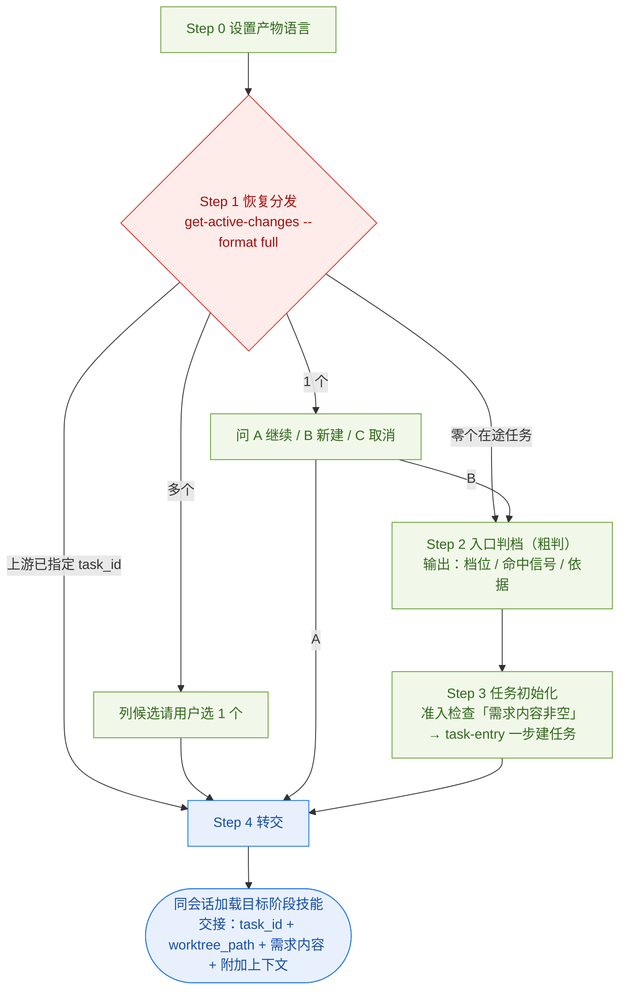

- **Step 1 的"上游已指定 `task_id`"分支必须免提问** —— 该情形只出现在**阶段出口的自动衔接**上（每次阶段切换一次）。
  在那里制造确认 = 每个阶段收尾都弹一次问题，且违背 `decision-point.md`「**只有一个安全下一步时不得制造确认**」。
- **Step 3 是一次调用**：`task-entry --kind coding --as intake --mode <档>` 一步完成「建目录 + 写 `workflow.mode` + 注册游标（幂等）」。
  ⚠️ 拆成三次脚本调用时，**中途失败会留下"建了目录但没注册"的孤儿 draft** —— 那正是 `resolve-drafts` 那类坑的来源。
  - 返回 `resolve-drafts`（磁盘有未注册残留）时：**A/B（采纳孤儿）** → 执行 `intake/policies/task-entry.md` §5.1 的两条命令后
    **直接进 Step 4**（🔴 **不要重跑 Step 3** —— draft 目录还在，会再报 `existing`，**死循环**）；**C（全部丢弃）** → 清理后重跑 Step 3。
  - 返回 `select` / `handover` / `resume` / `block` = **本步不该出现** ⇒ 说明状态在 Step 1 之后变了，**回 Step 1** 重判。
- **Step 4 的交接清单**（执行层的唯一输入）：`task_id`（**必给**；新建路径 = `draft_name`，正式名由 `specify` 在 finalize 时敲定、
  下一跳沿用新值）+ `worktree_path`（**空 = 主仓**，非空 ⇒ 被转交技能读产物 / 跑命令以该 worktree 为仓库根）
  + `需求内容`（原文，不摘要不改写）+ `附加上下文`（本次带来的文件 / 目录 / 说明）。

### 3.3 执行层的档位派生（**不询问用户，读 `workflow.mode`**）

与 `verify` 的 `verify_mode` 同构：**"只是选个强度 / 模式"的询问一律改由档位派生**。

| 阶段 | `tweak` | `normal` | `strict` |
|---|---|---|---|
| `specify` 澄清 | 轻量调研（`policies/lite-clarify.md`：现场勘察 → 一次 6 项确认 → 信息不足则聚焦追问 ≤2 轮） | 完整探索 3.0–3.4 | 同 `normal` |
| `specify` 出口 | **判档 + 推进**（🔴 全流程唯一的档位变更点） | 同 | 同 |
| `plan` 的「深化 design?」决策点 | ⛔ 不在序列 | ⛔ **不提供**（`design` 不在本档序列）→ 直接落 `tasks` 并标 `design.status=skipped` | ✅ 提供（`design` 在序列内） |
| `tasks` | 只读 `intention.md`（2.0 补建变更目录 + 迁入）；TDD **自动标注**；**免独立主审**（Step 7/8 本档豁免）+ **9.0 定稿确认** | 四件套；**询问 TDD**；独立主审 + OV | 同 + `detailed-design.md` |
| `build` | `inline` + `standard`（**不问**） | **询问**两项 | **询问**两项 |
| `verify` | 不变（`verify_mode` 自动派生） | 同 | 同 |
| `ship` | 不变（`artifact-backfill` 补齐四件套） | 同 | 同 |

> ⚠️ **被豁免的项目不是"实现缺失"**（如 `tweak` 档的独立主审、3.0–3.4 探索、拆分预检）—— 审计时**不要补回**，
> 补回等于取消该档。

---

## 4. 执行层各技能内部流程

以下 8 个技能中，前 7 个构成**执行层**（`specify` / `plan` / `design` / `tasks` / `build` / `verify` / `ship`）
—— 三条工作流**共用同一批执行层技能**，差别只在参与集合（见 §1 的 `modePhases`）；`retro` 为旁路，不占游标。

> `specify` 是**执行层的首段**（阶段表 `skill: null`，故 `skillForPhase` 对它返回 `null`），
> 由 `intake` 转交进入；其余各段由上一段出口**写 `phase` 后回 `intake`** 衔接（不是直接互相加载）。

### 4.1 specify（澄清）

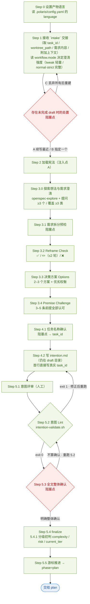

**三处阻塞点**：draft 处置（Step 1）、任务名（4.1）、全文确认（5.3）。
**档位分叉**：Step 3 的澄清强度按 `workflow.mode` 派生 —— `tweak` 走轻量调研（`policies/lite-clarify.md`），`normal` / `strict` 走 3.0–3.4 完整探索（3.0 是唯一带「提问下限」的步骤：≥3 问 / ≥3 类，模糊回答不计入）。
**出口判档**：5.4.1 分级初判只落两轴字段，**改档在 5.5**（全流程唯一的档位变更点）。

### 4.2 plan（提案）

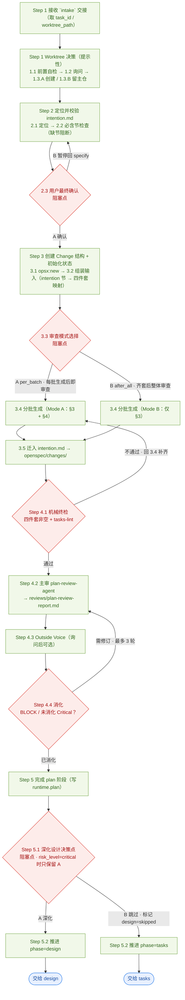

**plan 是唯一有两个出口阶段的技能**：A 深化 → `design`，B 跳过 → `tasks`。
**Mode A / B 的差别**：A 在分批生成时即逐批审查并冻结（`review-log.md`），Step 4.2 再做齐套跨批 Verdict；B 跳过批内审查，Step 4.2 是唯一制品主审出口。

### 4.3 design（深度设计）

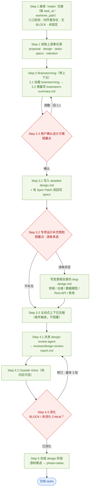

**职责边界**：深化 ≠ 替代 —— 禁止重写 `proposal.md` / 高层 `design.md` / `tasks.md` 的范围，缺口只能以 Spec Patch 回写 `specs/`。
**专项设计**：文件名必须为 `<slug>-design.md` 且落在变更根目录（扁平），禁止命名为 `design.md`、禁止子目录。

### 4.4 tasks（任务规划）

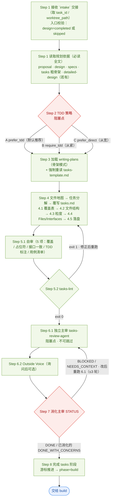

**与 plan / design 的关键差异**：主审**不可跳过**（`PLATFORM_DEGRADATION=inline|unsupported` 时直接阻断，不放行到 build）。
**TDD 策略决定的是子步骤形态**：`TDD 任务` = 用例清单 + 5 步，`非 TDD 任务` = 3 步；build 严格按标注执行，不得用全局开关覆盖。

### 4.5 build（构建）

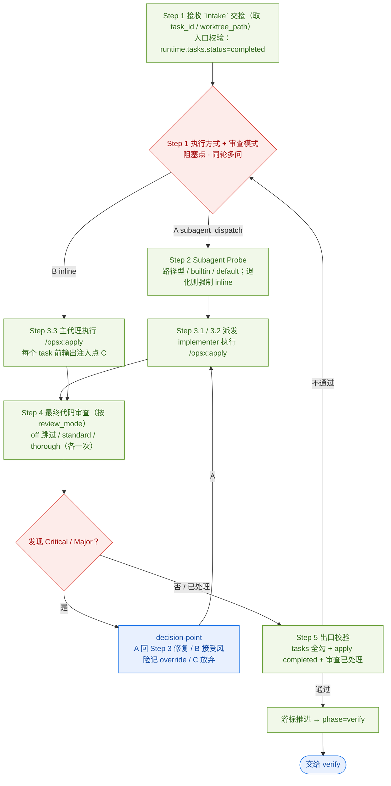

**apply 的唯一性**：业务实现代码只能在 `/opsx:apply` 内产生，禁止在 apply 之外手写。
**与 verify 去重**：Step 4 审过的 diff，verify 侧只聚焦「是否符合 spec/tasks」与「build 之后的新增改动」。

### 4.6 verify（验收）

`verify` 是 coding 族步骤最多的技能（17 步），按三段组织：

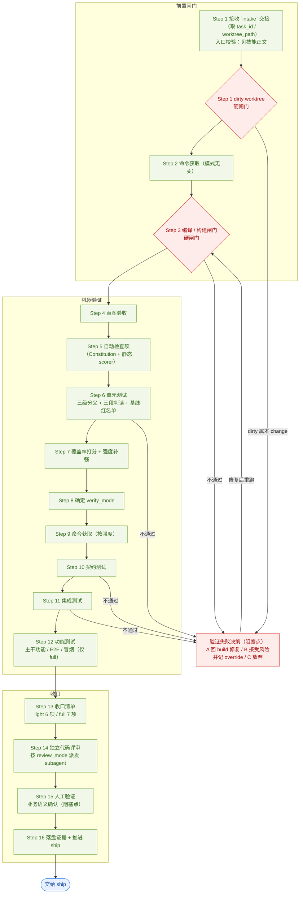

#### verify_mode 与相关取值

| 取值 | 决定位置 | 含义 |
|------|----------|------|
| `verify_mode` ∈ `light` / `full` | Step 8 | 验证强度。基础档由规模启发式给出，再由 `score_level` 补强，`risk_level=critical` 时一票升 `full` |
| `risk_level` ∈ `trivial` / `standard` / `critical` | 两轴复核 | **只升不降**；降到更低值必须由用户显式确认 |
| `review_mode` ∈ `off` / `standard` / `thorough` | `build` Step 1.2 | 决定 Step 14 是否派发独立代码评审、用哪种覆盖面 |
| `build_mode` ∈ `inline` / `subagent_dispatch` | `build` Step 1.1 | 决定 `/opsx:apply` 在主会话还是 implementer subagent 内执行 |

> `verify_mode` 的**唯一读取来源**是 `runtime.verify.verify_mode`。`state.yaml` 顶层的 `verify_mode` 是历史遗留死值，禁止读取。

### 4.7 ship（交付）

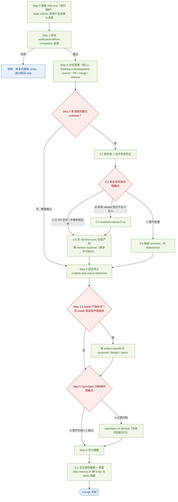

**Step 0 的锁**：`ship` 是唯一带串行保护的技能（`.polaris/.locks/ship.lock`）。
**3.5 的不可拆分**：必须先 `harness-sync` 合回产物、再 `git worktree remove`；顺序反了会丢 `.polaris/` 产物。

### 4.8 retro（复盘）

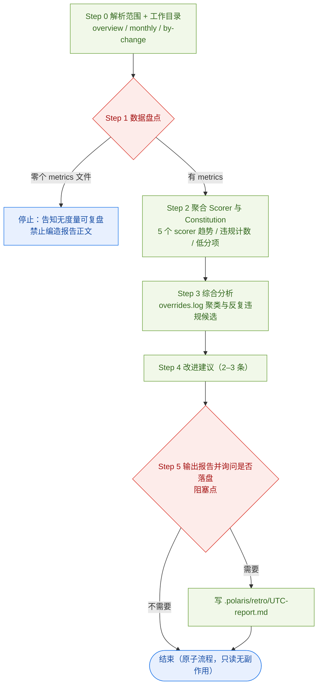

**retro 与其他技能的**四点**不同**：

1. **不经 `intake`（唯一的调度层豁免）** —— 它是**服务型只读技能**：不在任何档的阶段序列里、不需要 `task_id`、只读主仓全局 metrics / overrides ⇒ **由用户直接调用**（说「看度量 / 复盘」）。`intake` **不转交它**，任何技能的「自动衔接」也**不得**指向它；
2. **不写游标** —— 阶段表登记 `skill: null`，不进任何技能的下游，也不调 `state next`。⚠️ 若 `state.yaml` 真的出现 `phase=retro`，`intake` 按 `skill=null` **阻断**并提示用户「让它自己跑」；
3. **原子流程** —— 中间不设恢复点，中断即重跑（metrics 是只读输入，重跑无副作用）；
4. **报告默认不落盘** —— 经决策点询问后才写 `.polaris/retro/<UTC>-report.md`。

---

## 5. 人工确认（阻塞点）总览

所有阻塞点都走 `assets/zh/policies/decision-point.md`：**只有一个安全下一步时不得制造确认**。

| 技能 | 位置 | 确认内容 | 适用档 |
|------|------|----------|--------|
| `intake` | Step 1 | 在途任务**不唯一**时选 1 个；恰为 **1 个**时 A 继续 / B 新建 / C 取消。⚠️ **上游已指定 `task_id` 时免提问**（阶段出口的自动衔接） | 全档 |
| `intake` | Step 3 | `resolve-drafts`：孤儿 draft 的 **A 续写 / B 选择 / C 全部丢弃 / D 取消** | 全档 |
| `specify` | 轻量调研 **L2** | 理解摘要（**6 项**，一次性整体确认） | `tweak` |
| `specify` | **3.0 自检后** | 探索摘要整体确认（≥3 问 / ≥3 类） | `normal` / `strict` |
| `specify` | **3.1** | 需求拆分预检 | `normal` / `strict`（⛔ `tweak` 不做） |
| `specify` | 3.2 / 3.3 / 3.4 | Reframe 选择 / Options 选择 / Premise 逐条认可 | `normal` / `strict` |
| `specify` | **4.1** | 任务名 | 全档 |
| `specify` | **5.3** | `intention.md` 整体确认 | 全档 |
| `specify` | **5.5** | 🔴 **出口判档**：目标档 ≠ 当前档时问是否改档 | 全档 |
| `plan` | 4 | 提案整体评审（阻塞点） | `normal` / `strict` |
| `plan` | 4.3 | Outside Voice 复杂度建议 | `normal` / `strict` |
| `plan` | **6.1** | 是否深化设计 | ⛔ **仅 `strict`**（`design` 不在 `normal` 的序列里） |
| `design` | 2.3 / 3.2 / 4 | 设计方案确认 / 专项设计补充预检 / 设计评审 | `strict` 且已深化 |
| `tasks` | **3** | TDD 策略（`prefer_tdd` / `require_tdd` / `prefer_direct`） | ⛔ **`tweak` 不询问**（自动标注） |
| `tasks` | **7** | 独立主审 `tasks-review-agent` + Outside Voice 询问 | 🚫 **`tweak` 本档豁免** |
| `tasks` | **9.0** | `tasks.md` 定稿确认 | ✅ **`tweak` 专属**（替代被豁免的主审） |
| `build` | **2** | 执行方式 `build_mode` + 审查模式 `review_mode`（同轮多问） | ⛔ **`tweak` 不询问**（取 `inline` + `standard`） |
| `verify` | 4 / 15 | 意图验收确认；人工业务语义确认（质量底线） | 全档 |
| `verify` | 各闸门与检查项触发（全局决策点） | 验证失败 / override / 规格漂移决策 | A 回 build / B 接受风险并记 override / C 放弃 |
| `verify` | 15 | 人工业务语义确认 | 必现（light / full 都要） |
| `ship` | 3.3 | worktree 未合并时 | 3（已 PR 合并 / 本地 rebase-ff / 暂不处理） |
| `ship` | 5.1 | 是否归档 | 3（立即归档 / 暂不归档 / 跳过） |
| `retro` | 5 | 复盘报告是否落盘 | 2（需要 / 不需要） |

**共同规则**：明确整体确认才算确认；只对某条反馈、模糊回复（「差不多」「可以吧」）、沉默一律**不算确认**，必须重新发问。

---

## 6. 状态与游标约定

**两个文件、两类信息，各只有一个存放处**：

| 文件 | 存什么 | ⛔ 不存什么 |
|---|---|---|
| `.polaris/workflow.yaml` | **有哪些在途任务 + 在哪**：`task_id` / `worktree_path` / `started_at` / `channel?` | **阶段**（`phase` 已于 0.1.2 移出该文件） |
| `.polaris/tasks/<id>/state.yaml` | **任务身份 + 阶段 + 运行态**：顶层 `phase`（语义 = 「**接下来要执行的阶段**」）+ `workflow.mode` + `runtime.<阶段>.*` + 分级三字段 | — |

> 任务状态文件的**读取位置**由游标条目的 `worktree_path` 决定（空 = 主仓；非空 = worktree 内同名路径），
> 唯一入口是 `resolveTaskStatePath()`（`src/core/assets/polaris-paths.ts`）。

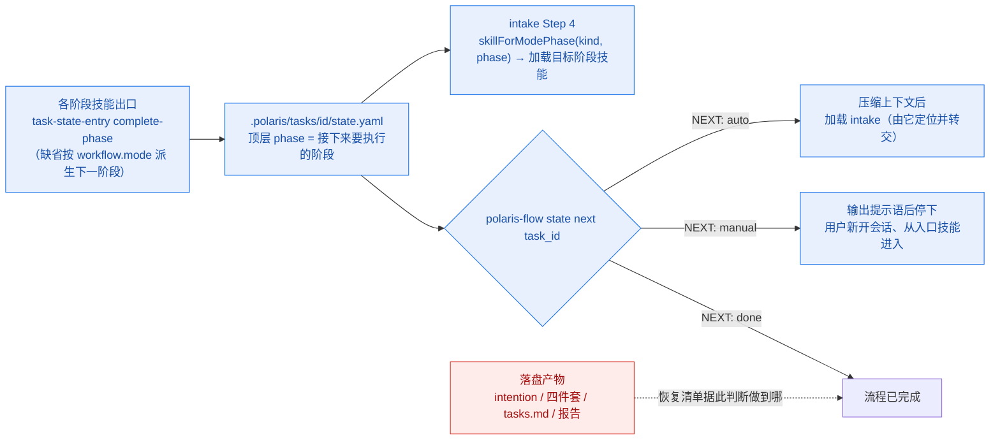

### 游标写入点

| 技能 | 写入时机 | 写入值 |
|------|----------|--------|
| `intake` | Step 3（**建条目**） | `task-entry --as intake --mode <档>` **一步完成**：建目录 + 写 `workflow.mode` + `append-active`（幂等） |
| `specify` | 出口 | 🔴 先按 5.5 判档（必要时 `set workflow.mode`），再 `complete-phase --phase specify`（**不传 `--next-phase`**，按 `workflow.mode` 派生：`tweak → tasks`；`normal` / `strict → plan`） |
| `plan` | 出口 | `phase=design`（深化）或 `phase=tasks`（跳过深化；`normal` 档**必须**走这条） |
| `design` | 出口 | `phase=tasks` |
| `tasks` | 出口 | `phase=build` |
| `build` | 入口 `enter-phase`；出口 | `phase=build`；出口推 `phase=verify` |
| `verify` | 出口 | `phase=ship` |
| `ship` | 出口 | 清游标 |
| `retro` | — | **不写游标**，只读聚合 |

> **建条目（`append-active`）与推 phase（`complete-phase`）是两件事**：`task-init` 只建目录、**不写游标**；
> **建条目归 `intake` 的 Step 3**（`task-entry` 内部完成），之后才由各阶段技能在自己的出口推进 `phase`。
> 缺建条目 → 后续的游标写操作会以 **exit 3** 阻断（找不到 entry）。
>
> 🔴 **`workflow.mode` 的变更只有一个位置** —— `specify` 的**出口**（见 §1.1）；其余阶段**不改 `mode`**。
> ⚠️ 早期设计曾在升/降档时改写 `mode` 并推到目标阶段的 `phase`，那是「单体技能」时代的做法，**已废止**。

### 恢复清单四件

任何写「恢复清单」的地方只写这四件：

1. **任务身份**：`task_id` 与产出目录
2. **进度依据**：读哪个落盘产物判断做到哪 —— 不要读 `state.yaml.phase`
3. **上一段产出**：本技能最近一次落盘的文件与字段
4. **起始步骤**：从本技能的哪个 Step 继续

> **`state.yaml` 只记身份与指针、不记进度** —— 进度一律以落盘产物为准（产物即状态）。

---

## 7. 通用约束

| 约束 | 内容 |
|------|------|
| 🔴 **入口不变式** | **执行层只有一个入口 = `intake`**：节点技能**不得被直接调用，也不得互相直接调用**（含阶段出口的自动衔接 —— 那一跳回 `intake`）。⚠️ **唯一例外**：`retro` 是**链外服务型只读技能** —— **由用户直接调用**，不经 `intake`、也不被任何技能自动转交（见 §4.8） |
| H8 | 每个 Step 入口输出可见状态行 |
| H10 | subagent 派发前必须 probe；优先读 SessionStart 注入与 `$SUBAGENT_PROBE_CACHE`，`inline` / `unsupported` 时不派发 |
| H12 | 写 `.polaris/workflow.yaml` 一律走 `scripts/workflow-entry.sh`（内含 lock 与写后校验） |
| H13 | 不调用两个 superpowers 派发驱动器 |
| H14 | **`需求内容` 为空则禁止建任务 / 加载技能** —— 该**准入检查**在 `polaris:coding:intake` 的 **Step 3**；需求**够不够详细**归 `specify` 澄清期（形式是**追问**，不是阻断）。生产故障 / 测试缺陷两条路径**不经** `intake`，由 `polaris:debug:diagnose` 校验补全 |
| Constitution 注入 | 注入点 A（澄清期加载）、C（每个 task 实施前输出适用原则）、D（出口合规审计） |
| TDD | Test-First 是 Constitution NON-NEGOTIABLE；三档**都不设**全局 TDD 开关（刻意不做 `tdd_mode`）—— `normal` / `strict` 档询问的是**标注策略**（`tdd_policy`），`tweak` 档按任务类型**自动标注** |

**TDD 自动标注规则**（`tweak` 档自动采用；`normal` / `strict` 档由 `tdd_policy` 决定松紧）：

- 新功能 / Bug 修复 / 含分支逻辑 → `<!-- TDD 任务 -->`（5 步）
- 配置修改 / 重命名 / 文档更新 / 依赖升级 / 构建脚本 / 脚手架 → `<!-- 非 TDD 任务 -->`（3 步）
- 无法判定 → **默认 TDD**
