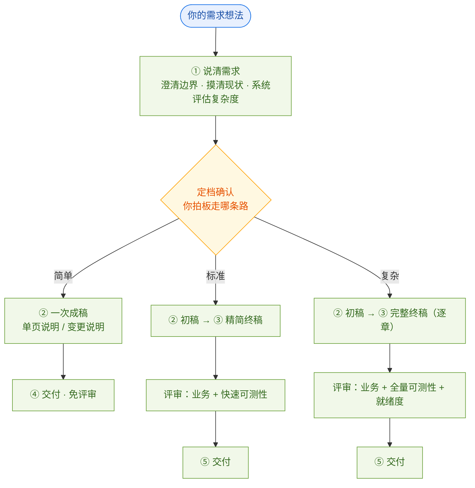

# PRD 需求工作流 · 设计思路（面向需求使用者）

> 这份文档讲清一件事：**从「一段需求想法」到「研发能直接开工的需求文档」，这条路是怎么设计的、为什么这么设计。**
>
> 读完你能理解三点：为什么不是所有需求都走同一条路、你在流程里要做什么、评审为什么有的多有的少。
>
> 面向读者：提需求的人（产品 / 业务 / 需求提出者）。不含技能名、目录、脚本等技术细节——那些在 `prd-workflow-flows.md` 与技能族 `README.md`，以它们为权威源。

---

## 一、这套流程要解决的问题

写需求，难的不是「写」，是「写对」。三个最常见的坑：

| 坑 | 表现 |
|---|---|
| 说不清 | 边界模糊、目标含糊、和现状的关系没理清 |
| 越写越大 | 范围中途膨胀，小需求写成了大工程 |
| 写到一半发现矛盾 | 和现有功能冲突，返工 |

流程把「写需求」拆成四步，**每步解决一个问题，且每步结束都要你确认、没确认不往下走**：

1. **说清需求** —— 你要的到底是什么、边界在哪、和现有功能什么关系（澄清）
2. **先写初稿** —— 轻量的几章，先对齐大逻辑，不急着展开细节
3. **补成终稿** —— 完整的正式文档，研发能照着做的粒度
4. **交付** —— 判断能不能交给研发，然后归档

---

## 二、提需求前，先想清楚这几件事

流程不要求你写一份规范文档，但**入口会先检查你的需求「说清楚了没」**。关键信息缺了，会先提示你补齐，省得后面澄清来回折腾。

**全新功能**，先说清三件事：

1. **背景 / 痛点** —— 为什么做、现状有什么问题
2. **核心目标** —— 做成什么样算成（要能验证，不是「更好用」）
3. **给谁用** —— 目标用户 / 角色

**改现有功能**（更常见），说清这三件：

1. **改哪个** —— 定位到模块 / 页面
2. **改成啥** —— 现状 → 目标的差异
3. **为什么改** —— 一句话即可

> 改现有功能时，「给谁用」默认就是现在正在用的人，不用重复说——除非这次动了角色 / 权限。

一时没想清楚的（比如范围边界、验收标准），**不用现在补**，流程会在澄清阶段带你问出来。只是如果你缺了上面那几件又坚持先往下走，会收到一个风险提示——后面澄清更费劲、档位可能评不准、写出来可能跑偏——你知悉即可继续。

---

## 三、核心设计思路：按需求大小，走不同的路

一句话：**不是所有需求都该走同一条路。**

「把按钮文案改两个字」和「打通三个系统、涉及资金结算」，风险天差地别。如果都走同一套全流程——澄清、逐章确认、三重评审——**简单需求会被流程拖死**（等几天确认、写一堆用不上的章节），**复杂需求反而评审不够**。

所以流程把需求分成三档，各走各的路：

| 档 | 典型需求 | 流程 | 你确认几次 | 评审强度 |
|---|---|---|---|---|
| **简单** | 改文案 / 调参数 / 加个字段 / 加条校验 | 说清 → 一次成稿 → 交付 | 4 次 | 不评审 |
| **标准** | 新增模块、多角色、多规则 | 说清 → 初稿 → 终稿 → 交付 | 5 次 | 业务评审 + 快速可测性检查 |
| **复杂** | 跨系统、动资金、核心链路改造 | 说清 → 初稿 → 逐章终稿 → 交付 | 逐章 | 全量评审 + 全量可测性 + 就绪度评估 |

---

## 四、怎么定档：系统评估，你拍板

定档不是让 AI 猜，也不是让你凭空选，而是**系统先评、你后确认**：

1. 系统按四个信号评估——**变更幅度、回归风险、可回滚性、现状复杂度**；
2. 把结论和理由回显给你看（档位 + 为什么）；
3. 你认可，或改一个档；你改的会记下来，用于以后校准「评得准不准」。

> 特别说明：你们现实里「简单需求」大多是**改现有功能**，不是从零建新功能。所以**现状复杂度**和**回归风险**是重点看的——改的地方越核心、越不能回滚，档位越高。

---

## 五、你在流程里扮演什么角色

你不需要写一个字，AI 写。你要做的是**在关键节点拍板**，保证方向不跑偏：

| 确认点 | 为什么要有 | 哪些档都要 |
|---|---|---|
| 命名 | 中文名 + 编号前缀，全链路引用，事后改名代价高 | 全部 |
| 定档 | 决定后面走哪条路、评审多严 | 全部 |
| 初稿确认 | 大逻辑对不对，再往下展开 | 全部 |
| 终稿确认 | 完整内容对不对 | 标准 / 复杂 |
| 交付确认 | 能不能交给研发 | 全部 |

两条原则（比「少问几次」更重要）：

- **逐章还是整稿，由档位定，不让你选**：简单 / 标准一次性看完整稿，复杂才逐章看。重的需求才值得逐章把关。
- **让你看「增量」，不是看全文**：每次确认只展示改了什么、重点标在哪、待决问题是什么，不让你从头读一遍。

---

## 六、评审为什么有的多有的少

原则：**把评审资源投到最容易出错、错了代价最大的地方。**

| 档 | 评审做法 | 理由 |
|---|---|---|
| 简单 | 不评审 | 改了能马上回滚、错了影响小，靠「你确认 + 可快速回滚」兜底 |
| 标准 | 业务评审（对不对 / 全不全 / 自不自洽）+ 快速可测性检查（每个功能能不能被验收） | 多角色多规则，需要可判定验收 |
| 复杂 | 全量业务评审 + 全量可测性（每个验收标准逐条补全）+ 就绪度评估（能不能交给研发） | 资金 / 合规 / 核心链路，需要硬证据 |

---

## 七、改现有功能（迭代）的专门设计

这是你们最常遇到的场景，流程有三件专门的事：

1. **先摸清现状** —— 现在这个功能是什么样、什么规则、什么数据；
2. **写成差异稿** —— 「现状 → 改动 → 验收」，不从头重写整份文档；
3. **回归风险单独评估** —— 改现有功能可能影响现有用户，哪怕改动本身很小。

简单迭代交付的是「变更说明」；复杂迭代在完整文档之外，还附带现状基线和回归 / 兼容专项。

---

## 八、几个贯穿始终的理念

1. **澄清定下来的东西是「唯一需求源」** —— 后面写文档不能凭空加需求，加需求先回到澄清。
2. **人工确认是硬闸门** —— 每步结束都要你明确确认，模糊回复、沉默、只对某条提意见都不算确认。
3. **写文档的保证质量，判断能否交付的独立判断** —— 避免「自己写的自己说行」；「文档写对」和「能不能交给研发」是两件事，分开判定。

---

## 九、一句话总结

> 复杂的需求值得复杂的流程，简单的需求不该被流程拖死。系统先按风险评档，你确认后走对应的路；你的职责是**在关键节点拍板**，AI 负责**把细节写对**；评审跟着风险走，把把关的力气花在刀刃上。
